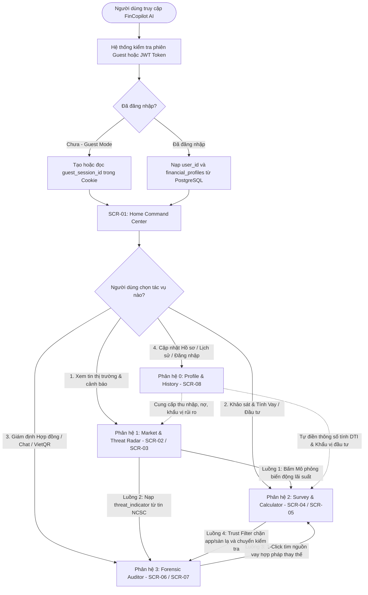
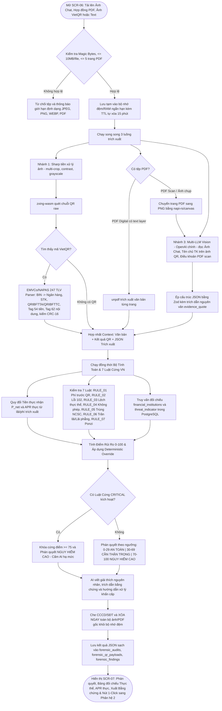
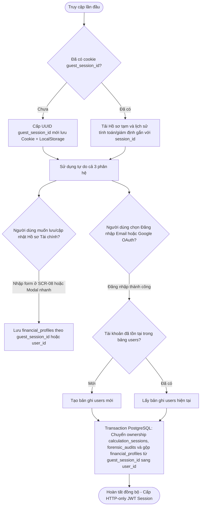

# FinCopilot AI — Flowchart Toàn Trình & Sơ đồ Wireframe Hệ thống (02)

> **Vai trò tài liệu:** Bản thiết kế luồng xử lý từ lúc người dùng nhập input đến khi nhận kết quả, đồng thời đặc tả sơ đồ điều hướng (Sitemap) và khung dây (Wireframe) cho toàn bộ 9 màn hình (`SCR-01..SCR-09`) của hệ thống Web Responsive (Desktop + Mobile-first). Đồng bộ 100% với [00_CHEATSHEET_CHOT.md](file:///D:/Documents/OU-TongHop-Project/MoMo/docs/specs/00_CHEATSHEET_CHOT.md), [01_DeBai_YeuCau_NghiepVu.pdf](file:///D:/Documents/OU-TongHop-Project/MoMo/docs/specs/01_DeBai_YeuCau_NghiepVu.pdf), [03_TechStack_KienTruc_ERD.md](file:///D:/Documents/OU-TongHop-Project/MoMo/docs/specs/03_TechStack_KienTruc_ERD.md), [04_UI_Prototype.html](file:///D:/Documents/OU-TongHop-Project/MoMo/docs/specs/04_UI_Prototype.html), [05_Agent_Coding_Spec.md](file:///D:/Documents/OU-TongHop-Project/MoMo/docs/specs/05_Agent_Coding_Spec.md) và [UserStory.pdf](file:///D:/Documents/OU-TongHop-Project/MoMo/docs/specs/UserStory.pdf).

---

## Phần A. System & User Flowcharts (Luồng Xử lý Toàn trình)

### 1. Flowchart 0 — Master End-to-End Journey & Vòng tròn Khép kín 3 Phân hệ



---

### 2. Flowchart 1 — Phân hệ 1: Market & Threat Radar (Ingestion & User Flow)

Bao gồm cả **Luồng nền tự động (Cron Ingestion)** và **Luồng người dùng (kế thừa đầy đủ nhánh `R01–R14` từ `UserStory.pdf`, kết nối `X01–X06` sang Phân hệ 2)**.

```mermaid
flowchart TD
    subgraph BG["Luồng nền định kỳ - BullMQ Cron Job"]
        CRON(["Scheduler kích hoạt định kỳ"]) --> FETCH["Thu thập RSS và API: CafeF, Vietstock, VnEconomy, NHNN, NCSC"]
        FETCH --> FETCH_OK{"Fetch nguồn thành công?"}
        FETCH_OK -- "Lỗi nguồn" --> MARK_ERR["Cập nhật last_fetch_status = ERROR, giữ nguyên last_success_at, không đẩy tin cũ thành mới"]
        FETCH_OK -- "Thành công" --> NORM["Chuẩn hóa URL và tính SHA-256 content_hash"]
        NORM --> DEDUP{"Đã tồn tại bài trùng?"}
        DEDUP -- "Trùng" --> LINK_SRC["Ghi thêm nguồn vào article_source"]
        DEDUP -- "Tin mới" --> CLASSIFY["Phân loại chủ đề vào article_category"]
        CLASSIFY --> IS_ALERT{"Tin cảnh báo từ nguồn trusted?"}
        IS_ALERT -- "Có - NCSC hoặc NHNN" --> ALERT_EXT["Tạo threat_alert VERIFIED, threat_evidence và tách threat_indicator đẩy sang Phân hệ 3"]
        IS_ALERT -- "Tin vĩ mô bình thường" --> SAVE_ART["Lưu market_article và cập nhật trạng thái nguồn SUCCESS"]
    end

    subgraph UF["Luồng người dùng đọc tin & phân tích tác động"]
        U_IN(["Mở SCR-02: Market & Threat Radar Feed"]) --> TAB{"Chọn tab xem?"}
        TAB -- "Tin thị trường" --> READ_ART["Mở SCR-03: Xem tiêu đề, nguồn, ngày công bố, link gốc"]
        READ_ART --> CHECK_PROF{"Đã có Hồ sơ tài chính - R07?"}
        CHECK_PROF -- "Có" --> AI_PERS["AI phân tích tác động cá nhân hóa: tách Dữ kiện gốc và Nhận định AI"]
        CHECK_PROF -- "Chưa" --> AI_GEN["AI phân tích tổng quát kèm giả định minh bạch và nút gợi ý nhập hồ sơ"]
        AI_PERS --> ACT_SIM{"Người dùng muốn mô phỏng tác động lãi suất?"}
        AI_GEN --> ACT_SIM
        ACT_SIM -- "Có - X04" --> GOTO_P2(["Chuyển sang SCR-04/SCR-05 kèm mức biến động lãi suất"])
        ACT_SIM -- "Không" --> BACK_DASH(["Quay về Dashboard"])

        TAB -- "Cảnh báo lừa đảo" --> READ_AL["Đọc cảnh báo: dấu hiệu, thủ đoạn, cách phòng tránh, verification_status"]
        READ_AL --> CHECK_TRUST{"Trạng thái xác minh?"}
        CHECK_TRUST -- "VERIFIED" --> SHOW_VER["Hiển thị nguồn xác thực NHNN hoặc NCSC và thời gian phát hành"]
        CHECK_TRUST -- "UNVERIFIED" --> SHOW_UNVER["Hiển thị nhãn Cảnh báo chưa xác minh - không kết luận như sự thật"]
    end
```



---

### 3. Flowchart 2 — Phân hệ 2: Multi-Provider Survey & Deterministic Calculator

Thể hiện đầy đủ luồng từ **User Input** ➔ **Trust Filter** ➔ **Hybrid Data Lookup (Catalog chuẩn hóa + Web Fallback)** ➔ **Deterministic Math Engine (`decimal.js`)** ➔ **DTI & Rate Shock Simulator** ➔ **AI Explanation**.

```mermaid
flowchart TD
    IN(["Mở SCR-04: Nhập nhu cầu Vay / Tích lũy / Nhập tay"]) --> PREFILL{"Có dữ liệu chuyển từ Phân hệ 1 hoặc 3?"}
    PREFILL -- "Có" --> AUTO_FILL["Tự điền Số tiền, Kỳ hạn, Lãi suất shock hoặc Thu nhập từ Hồ sơ"]
    PREFILL -- "Không" --> MODE{"Chọn chế độ Phân hệ 2"}
    AUTO_FILL --> MODE

    MODE -- "Chế độ A: Khảo sát & Tính Vay" --> INPUT_L["Nhập Số tiền P, Kỳ hạn n, Hình thức, Mục đích, Tên đơn vị muốn kiểm tra nếu có"]
    MODE -- "Chế độ B: Khảo sát & Tính Tích lũy/Đầu tư" --> INPUT_I["Nhập Vốn đầu C0, Góp tháng PMT, Kỳ hạn n, Khẩu vị rủi ro"]
    MODE -- "Chế độ C: Nhập tay & So sánh - US-lo1..lo4" --> INPUT_M["Nhập thông số 1 hoặc nhiều gói tự chọn: lãi niêm yết, kiểu tính, phí, ưu đãi"]

    INPUT_L --> VALIDATE{"Kiểm tra Zod Schema hợp lệ?"}
    INPUT_I --> VALIDATE
    INPUT_M --> VALIDATE
    VALIDATE -- "Sai định dạng hoặc âm" --> ERR_UI["Hiển thị lỗi chi tiết ngay tại trường nhập"]

    VALIDATE -- "Hợp lệ" --> TRUST_CHK{"Tên đơn vị/app người dùng nhập có bị Trust Filter chặn?"}
    TRUST_CHK -- "Phát hiện app đen / sàn ảo / Ponzi" --> BLOCK_TO_P3["Hiển thị cảnh báo Trust Filter và nút chuyển sang Phân hệ 3 giám định"]
    TRUST_CHK -- "Hợp lệ hoặc Khảo sát thị trường" --> SRC_SELECT{"Nguồn dữ liệu khảo sát"}

    SRC_SELECT -- "Chế độ C - Nhập tay" --> MATH_CORE
    SRC_SELECT -- "Chế độ A hoặc B" --> CAT_QUERY["Truy vấn PostgreSQL Catalog các tổ chức được NHNN/UBCKNN cấp phép - nhãn Đã chuẩn hóa"]
    CAT_QUERY --> NEED_WEB{"Người dùng bật Tra cứu Web mở rộng?"}
    NEED_WEB -- "Có" --> WEB_FETCH["AI Search trích xuất biểu lãi công khai kèm link nguồn - gắn nhãn Tham khảo web"]
    NEED_WEB -- "Không" --> MATH_CORE
    WEB_FETCH --> MATH_CORE

    MATH_CORE["Deterministic Math Engine - decimal.js"] --> CALC_BRANCH{"Nhánh phép tính"}
    CALC_BRANCH -- "Vay vốn" --> CALC_LOAN["Tính EMI / Gốc đều, Tổng lãi, Tổng phí, P_net thực nhận, Newton-Raphson APR/EAR, Lịch từng tháng"]
    CALC_BRANCH -- "Tích lũy & Quỹ mở" --> CALC_INV["Tính lãi kép + DCA, trừ phí quản lý/bán/thuế 0.1%, 3 kịch bản Thận trọng - Cơ sở - Tích cực"]

    CALC_LOAN --> HAS_DTI{"Có nhập Thu nhập, Chi phí, Nợ hiện tại?"}
    HAS_DTI -- "Có" --> DTI_CALC["Tính DTI % và Dư tiền sinh hoạt - Gắn 4 mức cảnh báo dưới 35% đến trên 50%"]
    HAS_DTI -- "Chưa" --> SHOCK_SIM
    DTI_CALC --> SHOCK_SIM["Mô phỏng kịch bản đổi lãi suất cố định / thả nổi theo thanh trượt Delta r"]

    CALC_INV --> AI_EXP["AI Gateway sinh giải thích đánh đổi theo ngôn ngữ tự nhiên - cấm sửa số liệu"]
    SHOCK_SIM --> AI_EXP
    AI_EXP --> OUT(["Hiển thị SCR-05: Bảng đối chiếu, Biểu đồ, Lịch trả nợ, DTI Gauge & Lưu session"])
```



---

### 4. Flowchart 3 — Phân hệ 3: Deal & Contract Forensic Auditor (Mũi nhọn MVP)

Thể hiện pipeline xử lý đa phương thức bất đồng bộ/song song, giải mã VietQR không phụ thuộc API ngân hàng trả phí, đối chiếu 7 Luật Cứng và cơ chế **Deterministic Override**.



---

### 5. Flowchart 4 — Luồng Guest-first, Hồ sơ Tài chính & Đồng bộ Tài khoản



---

## Phần B. Kiến trúc Thông tin (Sitemap) & Sơ đồ Wireframe Toàn Hệ thống

### 1. Sitemap & Navigation Shell (Desktop + Mobile-first)

```
FinCopilot AI (App Shell)
├── Desktop Topbar: Logo + Trạng thái AI Gateway + Badge Hồ sơ Tài chính (DTI sẵn sàng / Chưa điền) + Nút Đăng nhập / Tài khoản
├── Desktop Sidebar / Mobile Bottom Tab Bar (4 mục cố định):
│   ├── [1] Tổng quan (SCR-01)
│   ├── [2] Radar Tin & Bẫy (SCR-02) ──> Chi tiết Bài phân tích / Cảnh báo (SCR-03)
│   ├── [3] Khảo sát & Tính (SCR-04) ──> Kết quả Đối chiếu, Lịch nợ, DTI & Sốc lãi (SCR-05)
│   └── [4] Giám định Lừa đảo (SCR-06) ──> Phán quyết & Bằng chứng (SCR-07)
├── Nút góc phải / Tab phụ: Hồ sơ Tài chính & Lịch sử (SCR-08)
└── Đường dẫn quản trị nội bộ (/admin): Quản lý Nguồn tin, Catalog Sản phẩm & Luật (SCR-09)
```

---

### 2. Chi tiết Wireframe 9 Màn hình (`SCR-01` .. `SCR-09`)

#### `SCR-01`: Home Command Center (Trang chủ Điều phối)
- **Mục tiêu:** Đưa người dùng vào đúng nhu cầu trong 3 giây (đặc biệt làm nổi bật mũi nhọn Giám định VietQR/Hợp đồng ngay trên màn hình đầu tiên).

```text
+----------------------------------------------------------------------------------+
| [FinCopilot AI]    [Tổng quan] [Radar] [Khảo sát & Tính] [Giám định]   [Hồ sơ/ĐN]|
+----------------------------------------------------------------------------------+
| TRẠNG THÁI VÍ TIỀN: Hồ sơ: Thu nhập 18tr | Nợ hiện tại: 2tr  [Cập nhật nhanh]    |
+----------------------------------------------------------------------------------+
|  [LÁ CHẮN KHẨN CẤP - PHÂN HỆ 3]                                                  |
|  Nhận được hợp đồng PDF, chat Zalo hay mã VietQR đòi nộp phí trước?              |
|  +----------------------------------------------------------------------------+  |
|  |  Kéo thả Ảnh Chat / Hợp đồng PDF / Ảnh VietQR vào đây để giám định ngay    |  |
|  |  [Chọn tệp từ máy]   [Dán văn bản / QR]   [Chạy thử 3 mẫu lừa đảo demo]    |  |
|  +----------------------------------------------------------------------------+  |
+----------------------------------------------------------------------------------+
|  [PHÂN HỆ 1: RADAR HÔM NAY]            |  [PHÂN HỆ 2: TÍNH & KHẢO SÁT NHANH]     |
|  • [NHNN] Giữ ổn định lãi điều hành    |  Tôi muốn: (•) Vay vốn  ( ) Đầu tư      |
|    AI: Giảm áp lực vay thả nổi...      |  Số tiền: [ 50.000.000 đ ]  [24 tháng] |
|  • [CẢNH BÁO NCSC] Bẫy lỗi 102 VietQR  |  [Khảo sát & Tính chi phí các bên ->]   |
|  [Xem tất cả tin & cảnh báo ->]        |  Đã chuẩn hóa 18 Ngân hàng/CTTC/Quỹ     |
+----------------------------------------------------------------------------------+
```
- **Trạng thái đặc biệt:** Nếu chưa có Hồ sơ tài chính, thanh trạng thái trên cùng hiển thị nút vàng *"Thiết lập thu nhập trong 20 giây để mở khóa tính DTI & Phân tích cá nhân"*.

---

#### `SCR-02`: Market & Threat Radar Feed (Bảng tin Vĩ mô & Cảnh báo Lừa đảo)
- **Mục tiêu:** Tổng hợp tin vĩ mô đa nguồn và cảnh báo lừa đảo xác thực, lọc nhanh theo chủ đề.

```text
+----------------------------------------------------------------------------------+
| RADAR TIN TỨC & CẢNH BÁO SỚM                        [Trạng thái nguồn: 5/5 Tốt]  |
+----------------------------------------------------------------------------------+
| Tab: [ Tất cả ]  [ Tin thị trường & Lãi suất ]  [ Cảnh báo Lừa đảo (NCSC/NHNN) ] |
| Lọc chủ đề: [Lãi suất] [Ngân hàng] [Thị trường] [Chính sách] [Lừa đảo]  [Tìm...] |
+----------------------------------------------------------------------------------+
| +--------------------------------------+ +-------------------------------------+ |
| | [CẢNH BÁO ĐÃ XÁC MINH • NCSC] 2h trc | | [LÃI SUẤT • CafeF + VnEconomy] 4h   | |
| | Thủ đoạn giả nhân viên ngân hàng báo | | Lãi suất huy động nhóm Big4 ổn định| |
| | "lỗi 102" ép quét QR nộp phí mở khóa | | ở vùng thấp trong quý IV            | |
| | • Nhóm: Giả mạo NH / Phí giải ngân   | | • Tác động ví: Tích cực cho người   | |
| | • Đã nạp 3 chỉ dấu vào Lá chắn QR    | |   đang vay, cần tối ưu tiền nhàn rỗi| |
| | [Xem chi tiết & cách phòng tránh ->] | | [Phân tích tác động ví của tôi ->]  | |
| +--------------------------------------+ +-------------------------------------+ |
+----------------------------------------------------------------------------------+
```
- **Quy tắc UI bắt buộc (`US-r01` / `US-ro3`):** Nếu 1 nguồn RSS lỗi (ví dụ Vietstock timeout), hiện banner cảnh báo *"Nguồn Vietstock tạm gián đoạn lúc 16:30 — hệ thống giữ nguyên mốc cập nhật cũ và không đẩy tin cũ lên đầu"*. Tin `UNVERIFIED` mang badge xám *"Chưa xác minh"*.

---

#### `SCR-03`: Article Impact & Threat Alert Detail (Chi tiết Tác động & Cảnh báo)
- **Mục tiêu:** Hiện thực hóa quy tắc tách bạch **Dữ kiện gốc vs Nhận định AI** và cầu nối sang Phân hệ 2 (`X01–X06`).

```text
+----------------------------------------------------------------------------------+
| <- Quay lại Radar                                      Nguồn: NHNN • 22/11/2026  |
| TIÊU ĐỀ: NHNN định hướng giảm lãi suất cho vay tiêu dùng & sản xuất cuối năm     |
| Link gốc: https://sbv.gov.vn/... [Mở bài gốc]                                    |
+----------------------------------------------------------------------------------+
| CỘT TRÁI: DỮ KIỆN GỐC TỪ BÀI BÁO       | CỘT PHẢI: PHÂN TÍCH TÁC ĐỘNG CỦA AI     |
| • Trích dẫn số liệu chính xác từ nguồn | • [Chế độ: Cá nhân hóa theo Hồ sơ R07]  |
| • Thời điểm phát hành & cơ quan công bố| • Tác động vay: Nếu lãi thả nổi giảm 1% |
| • Không pha trộn suy đoán tại cột này  |   tiền trả hàng tháng giảm ~42.000đ/100tr|
|                                        | • Tác động tiết kiệm: Gửi NH giảm lợi   |
| (Nếu là Cảnh báo NCSC: Hiện bảng Dấu   |   suất ➔ cân nhắc Quỹ mở trái phiếu     |
|  hiệu, Thủ đoạn, Cách phòng tránh &    | * Lưu ý: Đây là ước tính tham khảo AI   |
|  Indicators STK/Domain đã trích xuất)  +-----------------------------------------+
|                                        | [Mô phỏng tác động lên khoản vay ->]    |
+----------------------------------------------------------------------------------+
```

---

#### `SCR-04`: Survey & Calculator Hub — Input Form (Nhập Nhu cầu Khảo sát & Tính toán)
- **Mục tiêu:** Đáp ứng đủ 3 chế độ nhập liệu (Khảo sát Vay, Khảo sát Tích lũy/Đầu tư, Nhập tay gói bất kỳ) và phần nhập nhanh DTI.

```text
+----------------------------------------------------------------------------------+
| KHẢO SÁT & TÍNH TOÁN TÀI CHÍNH AN TOÀN                                           |
+----------------------------------------------------------------------------------+
| [ Tab 1: Khảo sát & Tính Vay ] [ Tab 2: Tích lũy & Đầu tư ] [ Tab 3: Nhập tay ]  |
+----------------------------------------------------------------------------------+
|  1. NHU CẦU KHOẢN VAY                        2. ĐÁNH GIÁ SỨC TRẢ NỢ (DTI - Tùy   |
|  Số tiền cần vay: [ 50.000.000 ] VNĐ            chọn nhưng nên bật)              |
|  Kỳ hạn mong muốn: [ 24 ] tháng              [v] Lấy từ Hồ sơ tài chính (18tr)   |
|  Hình thức: [ Vay tín chấp tiêu dùng v ]     Thu nhập ròng/tháng: [ 18.000.000 ] |
|  Ưu tiên:   [ Tổng chi phí thấp nhất v ]     Chi phí sinh hoạt:   [  8.000.000 ] |
|  Kiểm tra tên đơn vị ngoài? (Tùy chọn):      Nợ phải trả khác:    [  2.000.000 ] |
|  [ Nhập tên app/ngân hàng muốn check... ]                                        |
|                                                                                  |
|  [ ] Quét thêm nguồn Web ngoài Catalog chuẩn hóa (gắn nhãn Tham khảo web)        |
|                                                                                  |
|                [ KHẢO SÁT CÁC BÊN & TÍNH TOÁN THỰC TẾ NGAY ]                     |
+----------------------------------------------------------------------------------+
| * Trust Filter tự động loại bỏ sàn ảo, app tín dụng đen không phép NHNN/UBCKNN.  |
+----------------------------------------------------------------------------------+
```
- **Khi chuyển sang Tab 2 (Tích lũy & Đầu tư):** Form đổi sang: Vốn ban đầu (`C_0`), Góp thêm hàng tháng (`PMT_in`), Thời gian nắm giữ (`n` tháng), Khẩu vị rủi ro (`Thận trọng` / `Cân bằng` / `Tích cực`), Mức cần thanh khoản.
- **Khi chuyển sang Tab 3 (Nhập tay & So sánh):** Cho phép thêm 1, 2 hoặc 3 cột phương án tùy chỉnh (Số tiền, Lãi suất %, Phương thức `Dư nợ giảm dần` / `Lãi phẳng trên gốc`, Kỳ hạn ưu đãi & biên độ thả nổi, Phí bảo hiểm/hồ sơ trừ trước, Phí tất toán sớm).

---

#### `SCR-05`: Survey Comparison Matrix, Amortization Schedule, DTI Gauge & Rate Shock Simulator
- **Mục tiêu:** Hiển thị toàn bộ kết quả tính toán xác định nhiều bên, biểu đồ, bảng lịch trả từng tháng, đồng hồ đo DTI và thanh trượt mô phỏng biến động lãi suất.

```text
+----------------------------------------------------------------------------------+
| KẾT QUẢ KHẢO SÁT & TÍNH TOÁN (50.000.000đ • 24 tháng)       [Sửa Input] [Lưu]    |
+----------------------------------------------------------------------------------+
| [TRUST FILTER NOTICE]: Đã lọc từ 12 tổ chức hợp pháp NHNN (Đã loại 0 đơn vị đen) |
+----------------------------------------------------------------------------------+
| 1. BẢNG ĐỐI CHIẾU NHIỀU BÊN (Sắp xếp theo: APR thực thấp nhất v)                 |
| Tổ chức / Gói        | Nguồn DL    | Trả/tháng  | Tiền thực nhận | APR thực |DTI |
| [x] Ngân hàng A - TC | Đã chuẩn hóa| 2.415.000đ | 50.000.000đ    | 14.8%/năm|34% |
| [x] CTTC B - Online  | Đã chuẩn hóa| 2.790.000đ | 48.500.000đ    | 31.2%/năm|36% |
| [ ] Ngân hàng C      | Tham khảo web|2.460.000đ | 50.000.000đ    | 16.2%/năm|34% |
+----------------------------------------------------------------------------------+
| 2. ĐỒNG HỒ DTI & DÒNG TIỀN          | 3. MÔ PHỎNG BIẾN ĐỘNG LÃI SUẤT (US-lo4)    |
|  DTI sau vay: 34.5% [AN TOÀN]       |  Áp dụng cho gói thả nổi sau kỳ ưu đãi:    |
|  Dư sinh hoạt còn: 5.585.000đ/tháng |  Biến động giả định: (-2%) [===●===] (+4%) |
|  * Đây là ước tính, không phải      |  Hiện tại: +2.0%/năm ➔ Trả tháng tăng +85k |
|    phê duyệt tín dụng của ngân hàng.|  Tổng chi phí tăng thêm: +1.620.000đ       |
+----------------------------------------------------------------------------------+
| 4. BIỂU ĐỒ GỐC/LÃI & BẢNG LỊCH TRẢ NỢ TỪNG THÁNG (Tháng 1 -> 24) [Xem đầy đủ v] |
| 5. GIẢI THÍCH ĐÁNH ĐỔI CỦA AI (Không chỉ dựa vào lãi niêm yết...)                |
+----------------------------------------------------------------------------------+
```
- **Chế độ Tích lũy / Đầu tư trên `SCR-05`:** Thay vùng 2 & 4 bằng **Biểu đồ 3 kịch bản tăng trưởng (Thận trọng / Cơ sở / Tích cực)**, bảng đối chiếu Giá trị gộp vs Tổng phí quản lý/bán/thuế 0.1% vs **Giá trị ròng thực nhận**, kèm cảnh báo *"Lợi suất quá khứ của quỹ mở không bảo đảm tương lai"*.

---

#### `SCR-06`: Forensic Auditor Workbench — Input & Privacy Guard (Phòng Giám định)
- **Mục tiêu:** Giao diện tải tài liệu đa phương thức trực quan, rõ cam kết bảo mật PII để người dùng an tâm tải hợp đồng thật và ảnh chụp chat Zalo.

```text
+----------------------------------------------------------------------------------+
| PHÒNG GIÁM ĐỊNH BẪY HỢP ĐỒNG & MÃ VIETQR (FORENSIC AUDITOR)                      |
+----------------------------------------------------------------------------------+
| [Cam kết bảo mật]: Ảnh & PDF chỉ xử lý tạm để trích xuất và TỰ ĐỘNG XÓA NGAY     |
| sau khi hoàn tất phân tích. Số CCCD và SĐT cá nhân được tự động che trong lịch sử.|
+----------------------------------------------------------------------------------+
| 1. TẢI TÀI LIỆU CẦN GIÁM ĐỊNH (Chọn 1 hoặc kết hợp nhiều loại cùng lúc)          |
| +------------------------------------------------------------------------------+ |
| |   [+ Ảnh chụp Chat Zalo / FB]    [+ Hợp đồng PDF (Scan/Digital)]            | |
| |   [+ Ảnh mã VietQR nhận tiền]    (Tối đa 5 ảnh + 1 PDF <= 5 trang, <= 20MB)  | |
| +------------------------------------------------------------------------------+ |
| Tệp đã chọn: [zalo_chat.jpg (x)] [hop_dong_vay.pdf (x)] [vietqr_phi.png (x)]     |
|                                                                                  |
| 2. HOẶC DÁN VĂN BẢN / NỘI DUNG TIN NHẮN ĐÒI TIỀN (Tùy chọn)                      |
| +------------------------------------------------------------------------------+ |
| | "Khoản vay của anh bị lỗi 102 do sai 1 số tài khoản, vui lòng quét QR nộp..."| |
| +------------------------------------------------------------------------------+ |
|                                                                                  |
|            [ BẮT ĐẦU GIÁM ĐỊNH ĐA TẦNG (QR + VISION + 7 LUẬT CỨNG) ]             |
+----------------------------------------------------------------------------------+
| DÙNG THỬ NHANH CASE MẪU (Cho Demo / Trải nghiệm):                                |
| [Mẫu 1: Bẫy lỗi 102 + VietQR cá nhân] [Mẫu 2: Lãi phẳng 0.9% + Phí ẩn] [Mẫu 3: Chuẩn]
+----------------------------------------------------------------------------------+
```

---

#### `SCR-07`: Forensic Verdict & Evidence Report (Báo cáo Phán quyết & Bằng chứng)
- **Mục tiêu:** Màn hình "đinh" trình diễn trước BGK — hiện rõ bằng chứng giải mã QR, vi phạm Luật Cứng, toán học APR thực và nút 1-click sang Phân hệ 2.

```text
+----------------------------------------------------------------------------------+
| [BANNER ĐỎ] PHÁN QUYẾT: NGUY HIỂM CAO — DẤU HIỆU LỪA ĐẢO (Điểm rủi ro: 95/100)  |
| Phát hiện 3 vi phạm Luật Cứng nghiêm trọng. KHUYẾN CÁO DỪNG CHUYỂN TIỀN NGAY!    |
+----------------------------------------------------------------------------------+
| 1. GIẢI MÃ VIETQR & ĐỐI CHIẾU THỰC THỂ (EMVCo/NAPAS 247 + Vision)                |
| • Pháp nhân tự xưng trên hợp đồng: "Công ty Tài chính ABC Việt Nam" (Không phép) |
| • Giải mã mã QR: Ngân hàng MB (BIN 970422) | STK: 0987xxx888 | Loại: QRIBFTTA   |
| • Tên chủ TK đọc trên ảnh: NGUYEN VAN X (Tài khoản CÁ NHÂN) -> [LỆCH THỰC THỂ!]  |
| • Số tiền QR yêu cầu chuyển trước: 2.500.000 VNĐ                                 |
+----------------------------------------------------------------------------------+
| 2. CÁC LUẬT CỨNG ĐÃ KÍCH HOẠT (BẤT KHẢ XÂM PHẠM)                                 |
| [CRITICAL] RULE_01_UPFRONT_FEE_QR: Yêu cầu chuyển phí bảo hiểm qua QR trước vay. |
|   Trích dẫn gốc: "...vui lòng thanh toán 2.500.000đ phí mở khóa để giải ngân..." |
| [CRITICAL] RULE_02_ERROR_102_FREEZE_TRAP: Dựng kịch bản "lỗi 102 đóng băng vốn". |
| [CRITICAL] RULE_03_ENTITY_MISMATCH: Hợp đồng công ty nhưng thu tiền qua TK cá nhân|
+----------------------------------------------------------------------------------+
| 3. BÓC TÁCH TOÁN HỌC XÁC ĐỊNH                                                    |
| • Khoản vay danh nghĩa: 50.000.000đ | Phí thu trước/giữ lại: 5.000.000đ          |
| • Tiền thực nhận (P_net): 45.000.000đ | Lãi niêm yết: 0.9%/tháng (Lãi phẳng)     |
| • LÃI SUẤT THỰC QUY ĐỔI (APR): 30.74%/năm (EAR 35.47% — gấp 2.8x lãi 10.8%/năm!) |
+----------------------------------------------------------------------------------+
| [XUẤT BÁO CÁO BẰNG CHỨNG (PDF/MD)]  [KHẢO SÁT & TÍNH NGUỒN VAY HỢP PHÁP ->] (P2) |
+----------------------------------------------------------------------------------+
```
- **Hành động khẩn cấp khi Verdict = `HIGH_RISK`:** Đính kèm hộp *"Nếu bạn đã lỡ chuyển tiền"* hướng dẫn khóa thẻ/khóa app ngân hàng, giữ biên lai giao dịch/ảnh chụp và trình báo Công an / cổng `canhbao.ncsc.gov.vn`.

---

#### `SCR-08`: Financial Profile & History Center (Hồ sơ Tài chính & Lịch sử)
- **Mục tiêu:** Quản lý tập trung Hồ sơ Tài chính cá nhân (phục vụ `R07` ở Phân hệ 1 và `DTI`/Khẩu vị ở Phân hệ 2), xem lịch sử tính toán/giám định và đăng nhập đồng bộ tài khoản.

```text
+----------------------------------------------------------------------------------+
| HỒ SƠ TÀI CHÍNH & LỊCH SỬ HOẠT ĐỘNG      Trạng thái: Guest Mode [Đăng nhập Google]|
+----------------------------------------------------------------------------------+
| 1. HỒ SƠ TÀI CHÍNH CÁ NHÂN (Dùng chung cho Radar R07 & DTI Phân hệ 2)            |
| • Thu nhập ròng/tháng: [18.000.000] đ  | Chi phí sinh hoạt: [8.000.000] đ       |
| • Nợ phải trả hiện tại:[ 2.000.000] đ  | Tiền nhàn rỗi:     [50.000.000] đ      |
| • Khẩu vị rủi ro: ( ) Thận trọng  (•) Cân bằng  ( ) Tăng trưởng                  |
| • Mục tiêu:       (•) Vay an toàn ( ) Tối ưu nợ ( ) Tích lũy sinh lời            |
|                                                         [ Lưu Hồ Sơ Tài Chính ]  |
+----------------------------------------------------------------------------------+
| 2. LỊCH SỬ GIÁM ĐỊNH (Đã xóa file gốc & che PII)  | 3. KỊCH BẢN VAY/ĐẦU TƯ ĐÃ LƯU|
| • 22/11 15:40 | Hợp đồng 50tr | [NGUY HIỂM 95đ]   | • 22/11 | Vay 50tr 24th DTI 34%|
| • 21/11 09:12 | VietQR cọc 5tr| [CẦN THẬN TRỌNG]  | • 20/11 | Quỹ mở + Tiết kiệm   |
+----------------------------------------------------------------------------------+
```

---

#### `SCR-09`: Admin / Data Operations Panel (Bảng Điều hành Dữ liệu — `/admin`)
- **Mục tiêu:** Phục vụ nhóm phát triển quản lý trực quan tình trạng cào RSS, cập nhật danh mục lãi suất/phí sản phẩm tài chính và kiểm soát các chỉ dấu lừa đảo mà không cần sửa code.

```text
+----------------------------------------------------------------------------------+
| DATA OPERATIONS PANEL (ADMIN)                              [Chạy Fetch RSS Ngay] |
+----------------------------------------------------------------------------------+
| 1. TRẠNG THÁI NGUỒN RADAR (market_source)                                        |
| Nguồn      | Loại | Trusted Alert | Lần cuối thành công | Trạng thái | Hành động |
| CafeF      | RSS  | false         | 22/11/2026 16:00    | SUCCESS    | [Fetch]   |
| NCSC       | WEB  | true          | 22/11/2026 16:00    | SUCCESS    | [Fetch]   |
| NHNN       | WEB  | true          | 22/11/2026 15:30    | ERROR      | [Retry]   |
+----------------------------------------------------------------------------------+
| 2. CATALOG SẢN PHẨM PHÂN HỆ 2 (financial_products)          [+ Thêm Sản phẩm mới]|
| Tổ chức     | Giấy phép   | Sản phẩm      | Lãi niêm yết | Hiệu lực   | Nguồn  |
| Ngân hàng A | NHNN-GP01   | Vay tín chấp  | 14.5% (Giảm) | 01/11/2026 | [Link] |
| Quỹ mở VCBF | UBCKNN-12   | Quỹ Cân bằng  | ~11.2%/năm   | 15/11/2026 | [Link] |
+----------------------------------------------------------------------------------+
```
