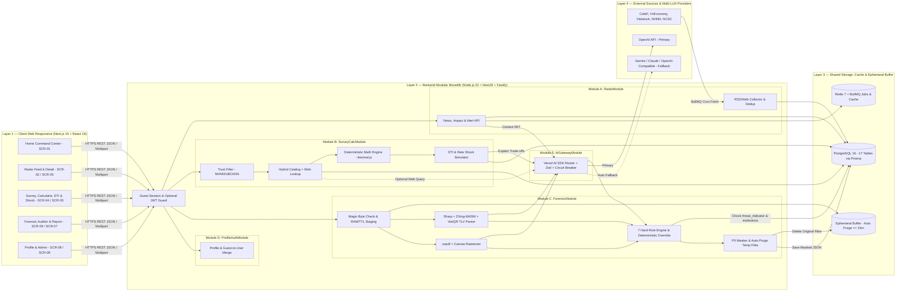
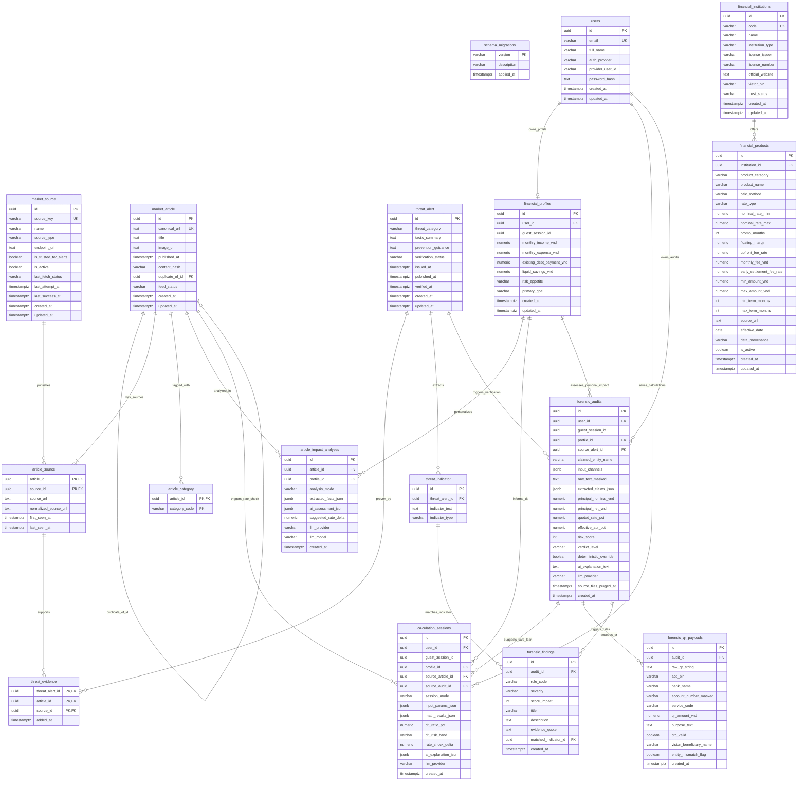

# FinCopilot AI — Tech Stack Tối Ưu, Kiến Trúc Hệ thống & ERD Chuẩn hóa (03)

> **Vai trò tài liệu:** Bản thiết kế kỹ thuật (Technical Blueprint) quy định chuẩn công nghệ tối ưu trên nền **Next.js + Node.js (TypeScript) + PostgreSQL + Multi-LLM AI Gateway (OpenAI làm chính)**, kiến trúc 4 tầng ([System-architect.png](file:///D:/Documents/OU-TongHop-Project/MoMo/docs/specs/System-architect.png), nguồn [system-architect.mmd](file:///D:/Documents/OU-TongHop-Project/MoMo/docs/specs/sources/system-architect.mmd)), lược đồ cơ sở dữ liệu **17 bảng** ([ERD.png](file:///D:/Documents/OU-TongHop-Project/MoMo/docs/specs/ERD.png), nguồn [erd.dbml](file:///D:/Documents/OU-TongHop-Project/MoMo/docs/specs/sources/erd.dbml)), bộ API Contract và lộ trình dựng MVP. Xem thêm Sequence/State/Golden Test Vectors tại [05_Agent_Coding_Spec.md](file:///D:/Documents/OU-TongHop-Project/MoMo/docs/specs/05_Agent_Coding_Spec.md).

---

## Phần A. Tech Stack Tối Ưu Toàn Diện (Node.js Backend + Multi-LLM)

### 1. Bảng Tech Stack Chuẩn cho Toàn Hệ thống

| Tầng hệ thống | Công nghệ lựa chọn | Lý do tối ưu cho FinCopilot AI |
| :--- | :--- | :--- |
| **Frontend Web (Responsive Desktop + Mobile-first)** | **Next.js 15 (App Router) + React 19 + TypeScript** | SSR/RSC tải nhanh bảng tin Radar SEO-tốt, hỗ trợ route rõ ràng cho cả 9 màn hình `SCR-01..SCR-09`, chuẩn hóa TypeScript đồng bộ với Backend. |
| **UI & Biểu đồ** | **Tailwind CSS v4 + shadcn/ui + Lucide Icons + Recharts + TanStack Query & TanStack Table** | `shadcn/ui` build nhanh form phức tạp & banner cảnh báo; `TanStack Table` sắp xếp/so sánh 15–25 gói vay mượt; `Recharts` vẽ lịch gốc/lãi & 3 đường cong Quỹ mở. |
| **Validation & State Client** | **Zod + React Hook Form + Zustand** | Validate form tức thì; chia sẻ schema Zod dùng chung giữa FE và BE qua Monorepo (`packages/shared-types`). |
| **Backend Core** | **Node.js 22 LTS + NestJS 11 (`@nestjs/platform-fastify`) + TypeScript** | Modular Monolith chia 5 module độc lập (`RadarModule`, `SurveyCalcModule`, `ForensicModule`, `ProfileAuthModule`, `AiGatewayModule`), Fastify nhanh gấp ~2x Express, hỗ trợ multipart stream upload tốt. |
| **Database & ORM** | **PostgreSQL 16 + Prisma ORM** | Đáp ứng chặt chẽ quan hệ 17 bảng, JSONB cho cấu trúc kết quả tính toán/giám định, transaction an toàn khi gộp Guest sang User. |
| **Cache, Queue & Cron** | **Redis 7 + BullMQ** | Chạy Cron cào RSS định kỳ, cache bảng Catalog & kết quả Radar `< 300ms`, xử lý bất đồng bộ/rate-limit job AI nếu lưu lượng cao. |
| **Thu thập Tin tức (Ingestion)** | **`rss-parser` + `undici` + `cheerio` + `@mozilla/readability`** | Cào nhanh RSS từ CafeF, VnEconomy, Vietstock và bóc tách nội dung sạch từ trang NHNN/NCSC. |
| **Toán Tài chính Xác định** | **`decimal.js` + Engine nội bộ (`packages/financial-math`)** | Tính tiền VNĐ, lãi kép, Newton-Raphson IRR/APR chuẩn xác tuyệt đối, loại bỏ 100% sai số dấu phẩy động IEEE-754 của JS `Number`. |
| **Xử lý Ảnh VietQR & PDF** | **`sharp` + `zxing-wasm` + Custom EMVCo TLV Parser + `unpdf` + `@napi-rs/canvas`** | Giải mã ảnh VietQR mờ/nghiêng từ Zalo không cần gọi API ngân hàng ngoài; đọc cả PDF digital lẫn PDF scan. |
| **Multi-LLM AI Gateway** | **Vercel AI SDK (`ai` + `@ai-sdk/openai` + `@ai-sdk/google` + `@ai-sdk/anthropic` + `@ai-sdk/openai-compatible`)** | Giao tiếp thống nhất qua 1 interface; **OpenAI làm Primary**, đổi provider/model hoặc fallback tự động chỉ bằng biến môi trường, hỗ trợ `generateObject` ép JSON bằng Zod. |
| **Auth & Security** | **Cookie Session (`guest_session_id`) + JWT HTTP-only + Google OAuth2 (`arctic` / Passport) + `file-type` (Magic Bytes) + `@fastify/rate-limit`** | Dùng ngay không cần đăng nhập; đăng nhập tùy chọn đồng bộ lịch sử; chặn file giả mạo định dạng. |
| **Testing & Observability** | **Vitest + Supertest + Pino Logger + OpenTelemetry / Sentry** | Test chính xác từng công thức tài chính, 7 Luật Cứng và EMVCo QR Parser; log có cấu trúc kèm masking PII. |

---

### 2. Giải pháp Chuyên sâu cho 4 Điểm Yếu Kỹ thuật của Node.js & Multi-LLM

Khi chọn **Node.js Backend** thay cho Python cho bài toán Fintech & Forensic, có 3 điểm yếu truyền thống của hệ sinh thái Node.js và 1 bài toán đa nhà cung cấp AI cần giải quyết triệt để ngay từ kiến trúc:

#### Kỹ thuật 1: Toán Tài chính Chính xác Tuyệt đối (`decimal.js` + Newton-Raphson APR)
- **Vấn đề:** Kiểu `number` của JavaScript (IEEE-754 float64) gây sai số cộng dồn (`0.1 + 0.2 = 0.30000000000000004`) và làm lệch lịch trả nợ 24–360 tháng.
- **Giải pháp:** Toàn bộ phép tính tại `packages/financial-math` nhận đầu vào dạng chuỗi/Decimal, dùng `Decimal.set({ precision: 28, rounding: Decimal.ROUND_HALF_UP })`. Lịch trả nợ tháng cuối tự động điều chỉnh phần dư làm tròn để `Tổng gốc trả == Số tiền vay`. Bộ giải IRR tìm `r_thực_tháng` kết hợp **Newton-Raphson** (hội tụ nhanh trong 6–10 vòng) với **Bisection fallback** (khi dòng tiền phi tuyến không hội tụ).

#### Kỹ thuật 2: Giải mã VietQR từ Ảnh Chụp Màn hình Mờ/Nhỏ (`sharp` + `zxing-wasm` + TLV Parser)
- **Vấn đề:** Thư viện QR JS cũ (`jsqr`) rất hay trượt khi ảnh chụp màn hình chat Zalo có độ phân giải thấp, khung viền nhiều chữ hoặc QR nằm ở góc ảnh.
- **Giải pháp Pipeline 4 bước trên RAM (`Buffer`):**
  1. Đọc ảnh bằng `sharp`, thử giải mã lượt 1 qua `zxing-wasm` (WebAssembly biên dịch từ C++ `zxing-cpp`, tốc độ và tỷ lệ nhận diện ngang OpenCV).
  2. Nếu lượt 1 chưa ra, dùng `sharp` tạo 3 biến thể tiền xử lý song song: (a) tăng tương phản + grayscale + sharpen, (b) crop vùng trung tâm/nửa dưới nơi thường đặt QR trên chat, (c) adaptive threshold nhị phân.
  3. Chuỗi QR thô giải mã được đưa qua **EMVCo / NAPAS 247 TLV Parser** tự viết (khoảng 120 dòng TS):
     - Kiểm tra `Tag 63` bằng thuật toán **CRC-16/CCITT-FALSE** (`0xFFFF`).
     - Tách `Tag 38` ➔ xác nhận GUID `A000000727` (NAPAS) ➔ lấy **Acquirer BIN (6 số)** ánh xạ qua bảng BIN nội bộ (VD: `970422` = MB, `970436` = Vietcombank, `970415` = VietinBank, `970407` = Techcombank...), **Account/Card Number**, **Service Code** (`QRIBFTTA` tài khoản cá nhân | `QRIBFTTC` số thẻ | Merchant).
     - Lấy `Tag 54` (số tiền cố định nếu có) và `Tag 62` (nội dung chuyển khoản).
  4. **Kết hợp Vision đọc Tên Chủ TK:** Vì chuẩn VietQR cá nhân không mã hóa họ tên trong mã QR, AI Vision đọc vùng chữ ngay quanh mã QR trên ảnh gốc để lấy `vision_beneficiary_name` đối chiếu với tên công ty trên hợp đồng (`RULE_03_ENTITY_MISMATCH`).

#### Kỹ thuật 3: Đọc Hợp đồng PDF cả Digital lẫn Bản Scan/Ảnh (`unpdf` + `@napi-rs/canvas`)
- **Vấn đề:** Hợp đồng lừa đảo thường là file PDF xuất từ ảnh chụp hoặc chèn dấu đỏ dạng bitmap khiến các thư viện đọc PDF thuần (`pdf-parse`) trả về chuỗi rỗng.
- **Giải pháp:**
  1. Kiểm tra Magic Bytes (`%PDF-`) và giới hạn tối đa 5 trang / 10MB.
  2. Dùng `unpdf` trích xuất text layer từng trang.
  3. Đánh giá mật độ text: nếu `chars_per_page >= 80`, gửi text + ảnh render trang quan trọng (có bảng lãi/chữ ký/dấu) cho AI; nếu `< 80` (PDF scan/ảnh), dùng `@napi-rs/canvas` + `pdfjs-dist` rasterize tối đa 5 trang thành ảnh PNG (`150–200 DPI`) trong RAM rồi đẩy thẳng vào **Multimodal Vision LLM** trích xuất có trích dẫn nguyên văn.

#### Kỹ thuật 4: Multi-LLM AI Gateway (OpenAI Làm Chính + Hỗ trợ Đa Nhà Cung cấp)
- **Kiến trúc `AiGatewayModule` dùng Vercel AI SDK (`ai`):** Mọi module nghiệp vụ (`RadarModule`, `SurveyCalcModule`, `ForensicModule`) chỉ gọi qua 1 interface duy nhất `AiGatewayService.generateStructured(taskType, schema, payload)`.
- **Bảng Routing & Fallback theo Nhiệm vụ (Cấu hình qua Env):**

| `taskType` | Model Chính (OpenAI Primary) | Model Dự phòng / Thay thế (Fallback) | Yêu cầu đầu ra |
| :--- | :--- | :--- | :--- |
| `RADAR_CLASSIFY_IMPACT` | `openai:gpt-4.1-mini` | `google:gemini-2.5-flash` / `openai-compatible` | JSON Schema (Dữ kiện gốc vs Nhận định AI) |
| `SURVEY_WEB_LOOKUP` | `openai:gpt-4.1-mini` (kèm Web Search tool) | `google:gemini-2.5-flash` (Search Grounding) | Trích xuất lãi/phí kèm `source_url` bắt buộc |
| `SURVEY_EXPLAIN` | `openai:gpt-4.1-mini` | `anthropic:claude-3-5-haiku` / `google:gemini-2.5-flash` | Giải thích đánh đổi (không sửa số liệu từ Math Engine) |
| `FORENSIC_VISION_EXTRACT` | `openai:gpt-4.1` (hoặc `gpt-4o`) | `google:gemini-2.5-pro` / `anthropic:claude-sonnet` | Multimodal đọc Ảnh chat + PDF scan + Tên chủ TK QR + Trích dẫn |
| `FORENSIC_VERDICT_NARRATIVE` | `openai:gpt-4.1-mini` | `google:gemini-2.5-flash` | Diễn giải phán quyết (chịu ràng buộc **Deterministic Override**) |

- **Cơ chế Circuit Breaker:** Nếu Provider chính trả lỗi `429 Rate Limit`, `5xx`, hoặc quá thời gian chờ (`timeout > 12s`), Gateway tự động chuyển ngay sang Provider thứ 2 trong danh sách `AI_PROVIDER_CHAIN=openai,google,anthropic` và ghi log lại `llm_provider` thực tế đã dùng.

---

## Phần B. Kiến trúc Hệ thống 4 Tầng Nâng cấp (Thay thế `System-architect.png`)

Sơ đồ dưới đây giữ nguyên tư duy phân tầng sạch của `System-architect.png` nhưng bổ sung đầy đủ **Module C (Forensic Auditor)**, **Module D (Profile & Guest/Auth)**, **Module E (Multi-LLM Gateway)**, **Trust Filter** và **PII Ephemeral Guard**:



---

## Phần C. Thiết kế Cơ sở Dữ liệu & ERD Hoàn chỉnh (17 Bảng)

### 1. Tổng hợp 17 Bảng (8 Bảng Kế thừa + 9 Bảng Mới)

| Nhóm | STT | Tên bảng | Nguồn gốc | Vai trò nghiệp vụ chính |
| :--- | :---: | :--- | :--- | :--- |
| **Hệ thống** | 1 | `schema_migrations` | Kế thừa `ERD.png` | Theo dõi lịch sử phiên bản di trú lược đồ DB. |
| **Phân hệ 1** | 2 | `market_source` | Kế thừa `ERD.png` | Danh sách nguồn tin & cảnh báo (CafeF, VnEconomy, Vietstock, NHNN, NCSC), cờ `is_trusted_for_alerts` và trạng thái fetch (`last_fetch_status`, `last_success_at`). |
| **Phân hệ 1** | 3 | `market_article` | Kế thừa `ERD.png` | Bài viết chuẩn hóa đã khử trùng qua `canonical_url` và `content_hash`, bổ sung `image_url` cho ảnh đại diện tin tức. |
| **Phân hệ 1** | 4 | `article_source` | Kế thừa `ERD.png` | Liên kết N-N giữa bài viết và nhiều nguồn đưa tin trùng. |
| **Phân hệ 1** | 5 | `article_category` | Kế thừa `ERD.png` | Phân loại chủ đề bài viết (Lãi suất, Ngân hàng, Thị trường, Chính sách, Lừa đảo). |
| **Phân hệ 1** | 6 | `threat_alert` | Kế thừa `ERD.png` | Bản ghi cảnh báo thủ đoạn lừa đảo, cách phòng tránh & `verification_status` (`VERIFIED`/`UNVERIFIED`). |
| **Phân hệ 1** | 7 | `threat_evidence` | Kế thừa `ERD.png` | Gắn bằng chứng bài báo & nguồn xác thực vào mỗi `threat_alert`. |
| **Phân hệ 1→3** | 8 | `threat_indicator` | Kế thừa `ERD.png` | Chỉ dấu lừa đảo cụ thể (STK, SĐT, domain, ví tiền mã hóa, mẫu lỗi 102) dùng để Phân hệ 3 đối chiếu tự động (`RULE_05`). |
| **Phân hệ 0** | 9 | `users` | **Bảng mới** | Tài khoản đăng nhập tùy chọn (Email / Google / GitHub OAuth). |
| **Phân hệ 0** | 10 | `financial_profiles` | **Bảng mới** | Hồ sơ tài chính cá nhân gắn theo `user_id` hoặc `guest_session_id` (thu nhập, chi phí, nợ hiện tại, tiền nhàn rỗi, khẩu vị rủi ro). |
| **Phân hệ 1** | 11 | `article_impact_analyses` | **Bảng mới** | Lưu kết quả AI phân tích tách bạch *Dữ kiện gốc* vs *Nhận định AI* theo từng bài báo và hồ sơ người dùng (nhánh `R07`). |
| **Phân hệ 2→3** | 12 | `financial_institutions` | **Bảng mới** | Danh mục tổ chức tài chính được NHNN/UBCKNN cấp phép (kèm `vietqr_bin` và `trust_status`) phục vụ cả Trust Filter (P2) lẫn đối chiếu pháp nhân (P3). |
| **Phân hệ 2** | 13 | `financial_products` | **Bảng mới** | Biểu lãi suất & biểu phí chuẩn hóa của các sản phẩm Vay, Tiết kiệm, Ví tích lũy, Quỹ mở (kèm `source_url`, `effective_date`, `data_provenance`). |
| **Phân hệ 2** | 14 | `calculation_sessions` | **Bảng mới** | Lưu lịch sử các phiên Khảo sát & Tính Vay/Đầu tư/DTI/Cú sốc lãi suất, giải thích AI và liên kết nguồn (`source_article_id`, `source_audit_id`). |
| **Phân hệ 3** | 15 | `forensic_audits` | **Bảng mới** | Hồ sơ giám định đa phương thức (kết quả JSON đã che PII, APR thực, điểm rủi ro 0–100, phán quyết 3 mức, `deterministic_override`, mốc xóa file gốc) kèm liên kết `profile_id` và `source_alert_id`. |
| **Phân hệ 3** | 16 | `forensic_qr_payloads` | **Bảng mới** | Dữ liệu giải mã VietQR chuẩn EMVCo/NAPAS 247 (`acq_bin`, ngân hàng, STK đã che, `service_code`, số tiền, tên chủ TK đọc từ Vision, cờ lệch thực thể). |
| **Phân hệ 3** | 17 | `forensic_findings` | **Bảng mới** | Chi tiết từng Luật Cứng (`RULE_01..RULE_07`) bị kích hoạt trong phiên giám định kèm trích dẫn nguyên văn (`evidence_quote`). |

---

### 2. Sơ đồ ERD Tổng thể (Mermaid `erDiagram`)



---

### 3. Mã nguồn DBML Đầy đủ (Copy dán trực tiếp vào `dbdiagram.io`)

```dbml
Project FinCopilot_AI {
  database_type: 'PostgreSQL'
  Note: 'ERD chuẩn hóa 17 bảng cho FinCopilot AI MVP (8 bảng kế thừa Phân hệ 1 + 9 bảng mới cho Phân hệ 0, 2, 3)'
}

// ==========================================
// 1. CÁC BẢNG KẾ THỪA TỪ ERD.png (8 BẢNG)
// ==========================================

Table schema_migrations {
  version varchar(100) [pk]
  description varchar(200) [not null]
  applied_at timestamptz [not null, default: `now()`]
}

Table market_source {
  id uuid [pk]
  source_key varchar(160) [unique, not null]
  name varchar(200) [not null]
  source_type varchar(24) [not null]
  endpoint_url text [not null]
  is_trusted_for_alerts boolean [not null, default: false]
  is_active boolean [not null, default: true]
  last_fetch_status varchar(10)
  last_attempt_at timestamptz
  last_success_at timestamptz
  created_at timestamptz [not null, default: `now()`]
  updated_at timestamptz [not null, default: `now()`]
}

Table market_article {
  id uuid [pk]
  canonical_url text [unique, not null]
  title text [not null]
  image_url text [note: 'Ảnh đại diện bài báo trích từ RSS/Web']
  published_at timestamptz
  content_hash varchar(64) [not null]
  duplicate_of_id uuid [ref: > market_article.id]
  feed_status varchar(10) [not null, default: 'ACTIVE']
  created_at timestamptz [not null, default: `now()`]
  updated_at timestamptz [not null, default: `now()`]
}

Table article_source {
  article_id uuid [not null, ref: > market_article.id]
  source_id uuid [not null, ref: > market_source.id]
  source_url text [not null]
  normalized_source_url text [not null]
  first_seen_at timestamptz [not null]
  last_seen_at timestamptz [not null]

  indexes {
    (article_id, source_id) [pk]
  }
}

Table article_category {
  article_id uuid [not null, ref: > market_article.id]
  category_code varchar(30) [not null]

  indexes {
    (article_id, category_code) [pk]
  }
}

Table threat_alert {
  id uuid [pk]
  threat_category varchar(40) [not null]
  tactic_summary text [not null]
  prevention_guidance text [not null]
  verification_status varchar(20) [not null, default: 'UNVERIFIED']
  issued_at timestamptz
  published_at timestamptz
  verified_at timestamptz
  created_at timestamptz [not null, default: `now()`]
  updated_at timestamptz [not null, default: `now()`]
}

Table threat_evidence {
  threat_alert_id uuid [not null, ref: > threat_alert.id]
  article_id uuid [not null]
  source_id uuid [not null]
  added_at timestamptz [not null, default: `now()`]

  indexes {
    (threat_alert_id, article_id, source_id) [pk]
    (article_id, source_id)
  }
}

Ref: threat_evidence.(article_id, source_id) > article_source.(article_id, source_id)

Table threat_indicator {
  id uuid [pk]
  threat_alert_id uuid [not null, ref: > threat_alert.id]
  indicator_text text [not null]
  indicator_type varchar(50) [not null, note: 'BANK_ACCOUNT | PHONE | DOMAIN | CRYPTO_WALLET | KEYWORD | QR_PATTERN']
}

// ==========================================
// 2. CÁC BẢNG MỞ RỘNG CHO 3 PHÂN HỆ (9 BẢNG)
// ==========================================

Table users {
  id uuid [pk]
  email varchar(255) [unique, not null]
  full_name varchar(150)
  auth_provider varchar(30) [not null, default: 'EMAIL', note: 'EMAIL | GOOGLE | GITHUB']
  provider_user_id varchar(255)
  password_hash text
  created_at timestamptz [not null, default: `now()`]
  updated_at timestamptz [not null, default: `now()`]
}

Table financial_profiles {
  id uuid [pk]
  user_id uuid [unique, ref: - users.id]
  guest_session_id uuid [unique]
  monthly_income_vnd numeric(18,2)
  monthly_expense_vnd numeric(18,2)
  existing_debt_payment_vnd numeric(18,2)
  liquid_savings_vnd numeric(18,2)
  risk_appetite varchar(20) [not null, default: 'BALANCED', note: 'CONSERVATIVE | BALANCED | GROWTH']
  primary_goal varchar(30) [not null, default: 'BORROW_SAFE', note: 'BORROW_SAFE | OPTIMIZE_DEBT | SAVE_INVEST']
  created_at timestamptz [not null, default: `now()`]
  updated_at timestamptz [not null, default: `now()`]
}

Table article_impact_analyses {
  id uuid [pk]
  article_id uuid [not null, ref: > market_article.id]
  profile_id uuid [ref: > financial_profiles.id, note: 'NULL nếu chạy phân tích tổng quát cho Guest chưa nhập hồ sơ']
  analysis_mode varchar(20) [not null, note: 'GENERAL | PERSONALIZED']
  extracted_facts_json jsonb [not null, note: 'Chỉ chứa dữ kiện trích từ bài báo']
  ai_assessment_json jsonb [not null, note: 'Nhận định & tác động ước tính của AI']
  suggested_rate_delta numeric(6,3)
  llm_provider varchar(40) [not null]
  llm_model varchar(80) [not null]
  created_at timestamptz [not null, default: `now()`]
}

Table financial_institutions {
  id uuid [pk]
  code varchar(50) [unique, not null]
  name varchar(200) [not null]
  institution_type varchar(30) [not null, note: 'BANK | FINANCE_COMPANY | FUND_HOUSE | EWALLET']
  license_issuer varchar(30) [not null, note: 'NHNN | UBCKNN']
  license_number varchar(100) [not null]
  official_website text [not null]
  vietqr_bin varchar(12)
  trust_status varchar(20) [not null, default: 'LICENSED', note: 'LICENSED | SUSPENDED | BLACKLISTED']
  created_at timestamptz [not null, default: `now()`]
  updated_at timestamptz [not null, default: `now()`]
}

Table financial_products {
  id uuid [pk]
  institution_id uuid [not null, ref: > financial_institutions.id]
  product_category varchar(30) [not null, note: 'UNSECURED_LOAN | SECURED_LOAN | SAVING | ACCUMULATION | OPEN_FUND']
  product_name varchar(200) [not null]
  calc_method varchar(30) [not null, note: 'REDUCING_BALANCE | DECLINING_PRINCIPAL | FLAT_RATE | COMPOUND_DCA']
  rate_type varchar(20) [not null, note: 'FIXED | FLOATING | PROMO_THEN_FLOATING | VARIABLE_NAV']
  nominal_rate_min numeric(7,4) [not null]
  nominal_rate_max numeric(7,4) [not null]
  promo_months int
  floating_margin numeric(7,4)
  upfront_fee_rate numeric(7,4) [default: 0]
  monthly_fee_vnd numeric(18,2) [default: 0]
  early_settlement_fee_rate numeric(7,4) [default: 0]
  min_amount_vnd numeric(18,2) [not null]
  max_amount_vnd numeric(18,2) [not null]
  min_term_months int [not null]
  max_term_months int [not null]
  source_url text [not null]
  effective_date date [not null]
  data_provenance varchar(20) [not null, default: 'CATALOG_VERIFIED', note: 'CATALOG_VERIFIED | WEB_REFERENCE']
  is_active boolean [not null, default: true]
  created_at timestamptz [not null, default: `now()`]
  updated_at timestamptz [not null, default: `now()`]
}

Table calculation_sessions {
  id uuid [pk]
  user_id uuid [ref: > users.id]
  guest_session_id uuid
  profile_id uuid [ref: > financial_profiles.id]
  source_article_id uuid [ref: > market_article.id, note: 'Cầu 1: Radar -> Khảo sát']
  source_audit_id uuid [ref: > forensic_audits.id, note: 'Cầu 4: Giám định -> Khảo sát']
  session_mode varchar(30) [not null, note: 'LOAN_SURVEY | INVESTMENT_SURVEY | MANUAL_COMPARE']
  input_params_json jsonb [not null]
  math_results_json jsonb [not null, note: 'Kết quả tính toán chính xác bằng decimal.js']
  dti_ratio_pct numeric(6,2)
  dti_risk_band varchar(20) [note: 'SAFE | MODERATE | HIGH_PRESSURE | CRITICAL_OVERLOAD']
  rate_shock_delta numeric(6,3)
  ai_explanation_json jsonb
  llm_provider varchar(40)
  created_at timestamptz [not null, default: `now()`]

  indexes {
    source_article_id
    source_audit_id
  }
}

Table forensic_audits {
  id uuid [pk]
  user_id uuid [ref: > users.id]
  guest_session_id uuid
  profile_id uuid [ref: > financial_profiles.id, note: 'Hồ sơ tài chính dùng tính tác động cá nhân']
  source_alert_id uuid [ref: > threat_alert.id, note: 'Cầu 2: Cảnh báo Radar -> Giám định']
  claimed_entity_name varchar(200)
  input_channels jsonb [not null, note: 'VD: ["CHAT_IMAGE", "PDF", "VIETQR_IMAGE"]']
  raw_text_masked text [note: 'Văn bản đã che CCCD/SĐT sau khi xóa file gốc']
  extracted_claims_json jsonb [not null]
  principal_nominal_vnd numeric(18,2)
  principal_net_vnd numeric(18,2)
  quoted_rate_pct numeric(7,4)
  effective_apr_pct numeric(8,4)
  risk_score int [not null]
  verdict_level varchar(20) [not null, note: 'SAFE | CAUTION | HIGH_RISK']
  deterministic_override boolean [not null, default: false]
  ai_explanation_text text [not null]
  llm_provider varchar(40) [not null]
  source_files_purged_at timestamptz [not null, note: 'Chứng minh thời điểm đã xóa tệp ảnh/PDF gốc']
  created_at timestamptz [not null, default: `now()`]

  indexes {
    profile_id
    source_alert_id
  }
}

Table forensic_qr_payloads {
  id uuid [pk]
  audit_id uuid [not null, ref: > forensic_audits.id]
  raw_qr_string text [not null]
  acq_bin varchar(12)
  bank_name varchar(120)
  account_number_masked varchar(64)
  service_code varchar(30) [note: 'QRIBFTTA | QRIBFTTC | MERCHANT']
  qr_amount_vnd numeric(18,2)
  purpose_text text
  crc_valid boolean [not null]
  vision_beneficiary_name varchar(150)
  entity_mismatch_flag boolean [not null, default: false]
  created_at timestamptz [not null, default: `now()`]
}

Table forensic_findings {
  id uuid [pk]
  audit_id uuid [not null, ref: > forensic_audits.id]
  rule_code varchar(50) [not null, note: 'RULE_01..RULE_07']
  severity varchar(20) [not null, note: 'CRITICAL | HIGH | MEDIUM | LOW']
  score_impact int [not null]
  title varchar(200) [not null]
  description text [not null]
  evidence_quote text [not null]
  matched_indicator_id uuid [ref: > threat_indicator.id]
  created_at timestamptz [not null, default: `now()`]
}
```

---

## Phần D. REST API Contract & Cấu trúc Monorepo

### 1. Danh mục REST API Endpoints (`/api/v1`)

| Phân hệ | Method & Path | Mô tả chức năng chính |
| :--- | :--- | :--- |
| **Auth & Profile** | `POST /api/v1/auth/session/guest` | Khởi tạo/xác thực `guest_session_id` cookie. |
| **Auth & Profile** | `POST /api/v1/auth/login` & `POST /api/v1/auth/google` | Đăng nhập tùy chọn & tự động gộp dữ liệu từ `guest_session_id` sang `user_id`. |
| **Auth & Profile** | `GET /api/v1/profile` & `PUT /api/v1/profile` | Đọc và cập nhật Hồ sơ Tài chính cá nhân (`financial_profiles`). |
| **Phân hệ 1 (Radar)** | `GET /api/v1/radar/articles` | Lấy danh sách tin tức đã lọc theo chủ đề/từ khóa, kèm trạng thái từng nguồn RSS. |
| **Phân hệ 1 (Radar)** | `GET /api/v1/radar/articles/:id` | Lấy chi tiết bài báo + tách bạch Dữ kiện gốc vs Nhận định AI (theo Hồ sơ `R07`). |
| **Phân hệ 1 (Radar)** | `GET /api/v1/radar/alerts` & `GET /api/v1/radar/alerts/:id` | Lấy danh sách & chi tiết cảnh báo lừa đảo kèm nguồn xác thực và chỉ dấu `threat_indicator`. |
| **Phân hệ 2 (Survey)** | `POST /api/v1/survey/loan` | Chạy Trust Filter + Khảo sát nhiều Ngân hàng/CTTC + Tính toán `decimal.js`, APR thực, DTI và lịch trả nợ. |
| **Phân hệ 2 (Survey)** | `POST /api/v1/survey/investment` | Khảo sát & Tính toán Tiết kiệm, Ví tích lũy, Quỹ mở UBCKNN (3 kịch bản sau phí & thuế). |
| **Phân hệ 2 (Survey)** | `POST /api/v1/calculator/manual-compare` | Tính toán và so sánh 1 hoặc nhiều gói vay nhập tay (`US-lo1..lo4`) + mô phỏng sốc lãi suất. |
| **Phân hệ 2 (Survey)** | `GET /api/v1/survey/history` | Lấy lịch sử các phiên tính toán đã lưu của Guest hoặc User. |
| **Phân hệ 3 (Forensic)** | `POST /api/v1/forensic/audit` | Nhận `multipart/form-data` (tối đa 5 ảnh + 1 PDF &le; 5 trang + text) ➔ Giải mã VietQR + Vision + 7 Luật Cứng + APR + Tự xóa file tạm. |
| **Phân hệ 3 (Forensic)** | `GET /api/v1/forensic/audits/:id` & `GET /api/v1/forensic/audits` | Xem chi tiết báo cáo phán quyết và lịch sử giám định (đã che PII). |
| **Phân hệ 3 (Forensic)** | `GET /api/v1/forensic/audits/:id/export` | Xuất Báo cáo Bằng chứng dưới dạng `pdf` hoặc `markdown`. |
| **Admin Ops** | `POST /api/v1/admin/radar/fetch` | Kích hoạt thu thập RSS/NCSC thủ công & xem log trạng thái các nguồn. |
| **Admin Ops** | `GET/POST/PATCH /api/v1/admin/products` | Quản lý danh mục tổ chức & biểu lãi suất chuẩn hóa Phân hệ 2. |

### 2. Cấu trúc Thư mục Monorepo Đề xuất (`pnpm workspaces` / `Turborepo`)

```text
fincopilot-ai/
├── package.json
├── pnpm-workspace.yaml
├── turbo.json
├── docker-compose.yml               # PostgreSQL 16 + Redis 7 cho Local Dev
├── packages/
│   ├── shared-types/                # Zod schemas & TS DTO dùng chung FE + BE
│   └── financial-math/              # Pure TS + decimal.js (EMI, Flat->APR/EAR, DTI, DCA/Fund) + Unit tests
├── apps/
│   ├── web/                         # Next.js 15 + React 19 + Tailwind + shadcn/ui + Recharts
│   │   ├── src/app/                 # Routes cho SCR-01..SCR-09
│   │   ├── src/components/          # Dropzone, VietQR Inspector, DTI Gauge, Comparison Matrix
│   │   └── src/lib/                 # API client, TanStack Query hooks
│   └── api/                         # NestJS 11 + Fastify + Prisma + BullMQ
│       ├── prisma/
│       │   ├── schema.prisma        # Ánh xạ đủ 17 bảng
│       │   └── seed.ts              # Seed nguồn RSS + 18-25 gói Ngân hàng/CTTC/Quỹ mở + Mẫu NCSC
│       └── src/
│           ├── common/              # PII masker, Magic-byte validator, Auth guards
│           ├── modules/
│           │   ├── profile-auth/    # Guest session, Google/Email login, Profile merge
│           │   ├── radar/           # RSS collector, Dedup, Threat alert extractor
│           │   ├── survey-calc/     # Trust Filter, Hybrid Catalog + Web, Math wrapper, DTI
│           │   ├── forensic/        # Sharp+ZXing VietQR, unpdf/Canvas, 7 Hard Rules, Evidence PDF
│           │   └── ai-gateway/      # Vercel AI SDK (OpenAI primary + Gemini/Claude fallback)
│           └── main.ts
└── docs/                            # Lưu bộ 3 tài liệu Kim Chỉ Nam và tài liệu dự thi
```

---

## Phần E. Kiến trúc Triển khai (Deployment) & Lộ trình Build MVP

### 1. Môi trường Local & Production Tiết kiệm Chi phí

| Môi trường | Hạ tầng đề xuất | Ghi chú vận hành |
| :--- | :--- | :--- |
| **Local Development** | Docker Compose (`postgres:16-alpine` + `redis:7-alpine`) + `pnpm dev` | Chạy đồng thời `apps/web` (`:3000`) và `apps/api` (`:4000`), seed 1 lệnh có đủ dữ liệu demo. |
| **Cloud Staging / Thi đấu** | **Frontend:** Vercel (Free Hobby/Pro)<br/>**Backend API:** Railway / Render / Fly.io (1 container Node 22)<br/>**PostgreSQL:** Neon hoặc Supabase (Free/Low-tier)<br/>**Redis:** Upstash Redis Serverless | Chi phí vận hành gần như 0đ ngoài tiền API OpenAI (`gpt-4.1-mini` rất rẻ; `gpt-4.1`/`gpt-4o` chỉ gọi ở Phân hệ 3 Vision). Hỗ trợ SSL tự động và scale tức thì khi demo. |

### 2. Lộ trình Triển khai MVP Chia 4 Giai đoạn (Không Nghẽn Cổ Chai)

1. **Giai đoạn 1 — Nền tảng, Database & Toán học Thuần (`packages/financial-math` + `Prisma`):**
   - Dựng Monorepo, chạy Docker Postgres + Redis, viết `schema.prisma` đủ 17 bảng và script `seed.ts` cho 5 nguồn Radar + ~18–25 gói vay/đầu tư chuẩn hóa.
   - Viết và kiểm thử 100% unit test bằng Vitest cho toàn bộ công thức tài chính `decimal.js` (EMI, Gốc đều, Lãi phẳng ➔ APR thực, Cú sốc thả nổi, DTI, Lãi kép Quỹ mở).
2. **Giai đoạn 2 — Multi-LLM Gateway & Mũi nhọn Phân hệ 3 (`AiGatewayModule` + `ForensicModule`):**
   - Dựng `AiGatewayService` với OpenAI primary + biến env chuyển provider.
   - Hoàn thiện Bộ giải mã VietQR (`sharp` + `zxing-wasm` + TLV Parser + bảng BIN NAPAS), bộ đọc PDF (`unpdf` + `@napi-rs/canvas`), **7 Luật Cứng** kèm `Deterministic Override` và xóa file tạm. Test ngay trên bộ 3 case mẫu (lỗi 102 QR cá nhân, lãi phẳng + phí ẩn, hợp đồng sạch).
3. **Giai đoạn 3 — Phân hệ 2 (`SurveyCalcModule`) & Phân hệ 1 (`RadarModule`):**
   - Hoàn thiện API Khảo sát Vay / Tích lũy / Nhập tay + Trust Filter + Web fallback gắn nhãn.
   - Hoàn thiện Cron RSS collector (`CafeF`, `VnEconomy`, `Vietstock`, `NHNN`, `NCSC`), Dedup, trích xuất `threat_indicator` đẩy sang Phân hệ 3 và phân tích AI tách 2 cột.
4. **Giai đoạn 4 — Giao diện Web Responsive (`apps/web`) & Kiểm thử 4 Luồng Khép kín:**
   - Dựng đủ 9 màn hình `SCR-01..SCR-09` theo `02_Flowchart_Wireframe.md`, kiểm tra hiển thị đẹp trên cả điện thoại và laptop.
   - Diễn tập chạy mượt Kịch bản Demo 5 phút và kiểm tra tính năng xuất Báo cáo Bằng chứng PDF/Markdown.
