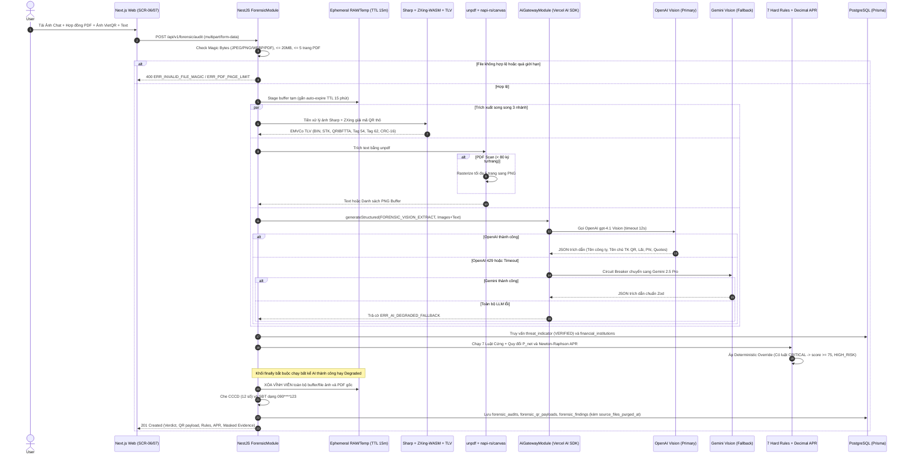
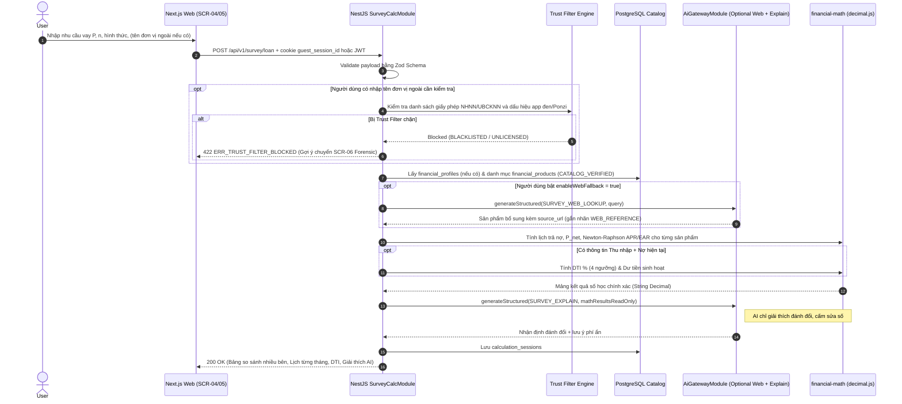
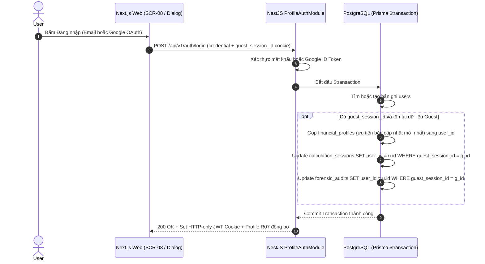
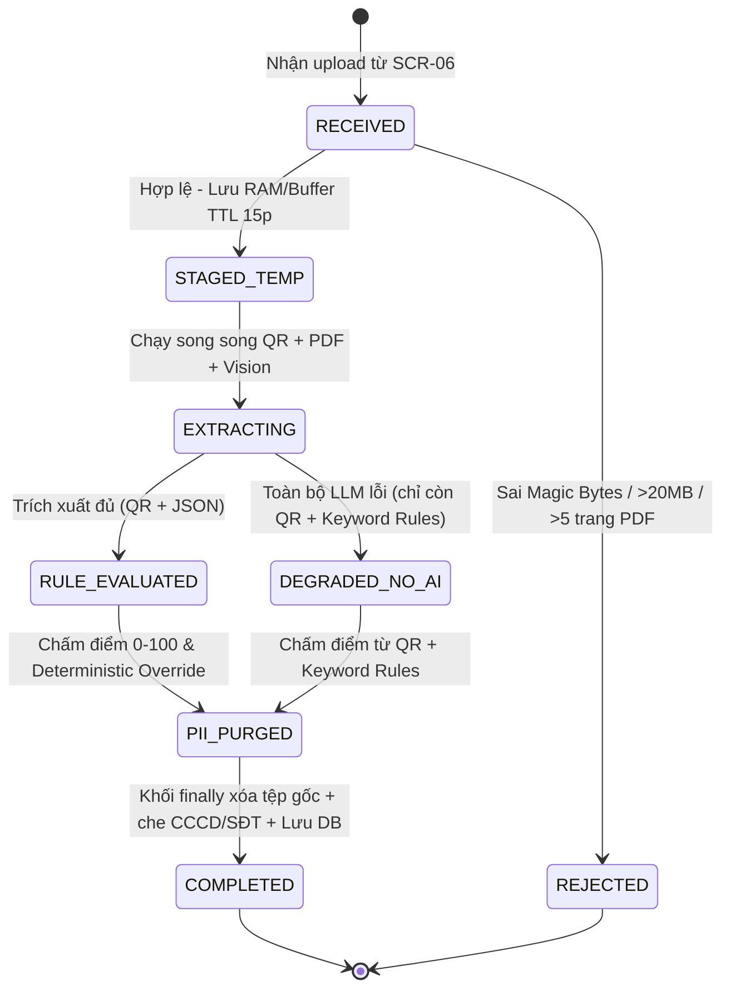
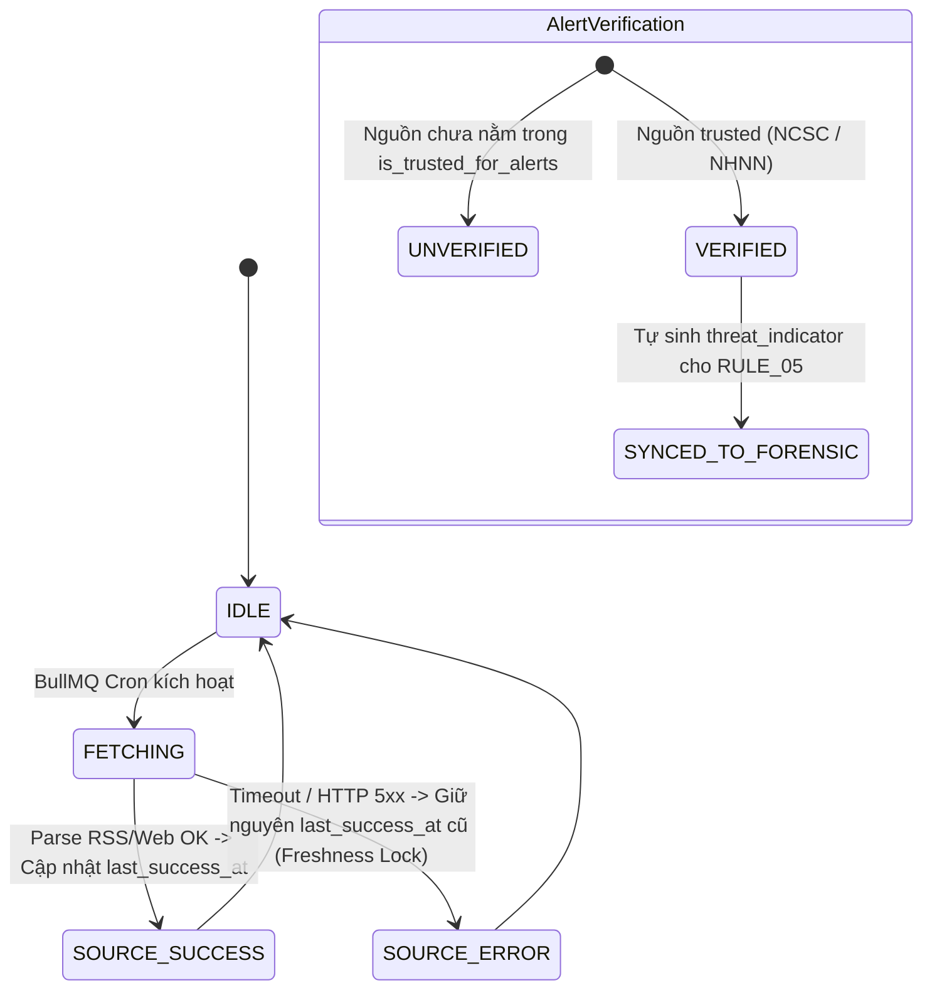
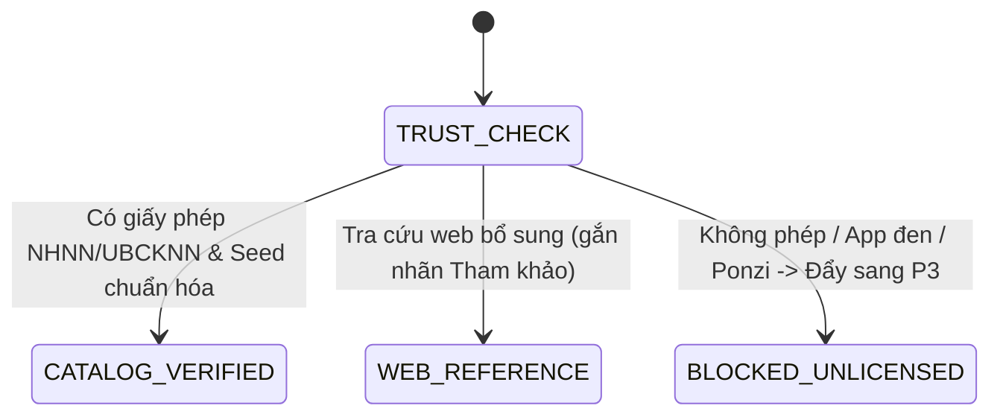

# FinCopilot AI — Agent-Ready Coding Specification (05)

> **Mục tiêu tài liệu:** Khóa chặt các hợp đồng kỹ thuật khi giao **AI Coding Agent** (hoặc nhóm kỹ sư FE/BE) triển khai mã nguồn thật trên Monorepo (`Next.js 15` + `NestJS 11 / Fastify` + `PostgreSQL 16 / Prisma` + `Multi-LLM AI Gateway`). Bao gồm **Sequence Diagrams**, **State Machines**, **JSON API Contracts**, **Prompt Guardrails** và **Golden Test Vectors (TDD)** đã kiểm chứng bằng số học thập phân chính xác.

---

## Phần 1. Ba Sequence Diagrams Chuẩn (Luồng Bất đồng bộ, Fallback & Transaction)

### 1.1. `SEQ-01`: Giám định Đa phương thức `POST /api/v1/forensic/audit` (Parallel + Circuit Breaker + PII Purge)



---

### 1.2. `SEQ-02`: Khảo sát & Tính toán Nhiều Bên `POST /api/v1/survey/loan` (Hybrid + Trust Filter)



---

### 1.3. `SEQ-03`: Đăng nhập Tùy chọn & Gộp Phiên Guest `POST /api/v1/auth/login`



---

## Phần 2. Ba State Machine Diagrams (Vòng đời Dữ liệu & Trạng thái Hệ thống)

### 2.1. Vòng đời Hồ sơ Giám định & File Tạm (`forensic_audits`)



### 2.2. Vòng đời Nguồn Tin & Cảnh báo Radar (`market_source` & `threat_alert`)



### 2.3. Vòng đời Độ tin cậy Sản phẩm Phân hệ 2 (`financial_products` & Trust Filter)



---

## Phần 3. JSON Request / Response Contracts & Error Codes

> **Quy ước kiểu dữ liệu bắt buộc cho FE & BE (`packages/shared-types`):**
> - Mọi số tiền (`VNĐ`) và tỷ lệ phần trăm (`%`) xuất ra từ `decimal.js` đều truyền dạng **chuỗi số thập phân chuẩn (`string`)** hoặc số nguyên VNĐ không dấu phẩy để tránh sai số khi parse JSON (Frontend chỉ format `toLocaleString('vi-VN')` ở tầng hiển thị).

### 3.1. `POST /api/v1/forensic/audit`
- **Request:** `multipart/form-data`
  - `files[]`: tối đa 5 ảnh (`image/jpeg`, `image/png`, `image/webp`) + tối đa 1 PDF (`application/pdf`, `<= 5` trang), tổng dung lượng `<= 20MB`.
  - `rawText` *(optional string)*: đoạn chat / điều khoản dán tay.
  - `rawQrString` *(optional string)*: chuỗi EMVCo nếu người dùng tự dán.
- **Response `201 Created`:**
```json
{
  "auditId": "7d1a2c3e-4b5a-4f6b-9c8d-1e2f3a4b5c6d",
  "verdictLevel": "HIGH_RISK",
  "riskScore": 95,
  "deterministicOverride": true,
  "claimedEntityName": "Công ty Tài chính ABC Việt Nam",
  "mathBreakdown": {
    "principalNominalVnd": "50000000",
    "upfrontFeeVnd": "5000000",
    "principalNetVnd": "45000000",
    "quotedRateLabel": "0.9%/tháng (Lãi phẳng)",
    "effectiveAprPct": "30.7436",
    "effectiveEarPct": "35.4678"
  },
  "qrPayloads": [
    {
      "acqBin": "970422",
      "bankName": "Ngân hàng TMCP Quân Đội (MBBank)",
      "accountNumberMasked": "098****321",
      "serviceCode": "QRIBFTTA",
      "qrAmountVnd": "2500000",
      "purposeText": "PHI GIAI NGAN LOI 102",
      "crcValid": true,
      "visionBeneficiaryName": "NGUYEN VAN HUNG",
      "entityMismatchFlag": true
    }
  ],
  "findings": [
    {
      "ruleCode": "RULE_01_UPFRONT_FEE_QR",
      "severity": "CRITICAL",
      "scoreImpact": 85,
      "title": "Yêu cầu nộp phí bảo hiểm / giải ngân trước qua QR",
      "description": "Tổ chức tín dụng hợp pháp không thu phí giải ngân trước qua QR cá nhân.",
      "evidenceQuote": "cần chuyển 2.500.000đ phí bảo hiểm mở khóa giải ngân",
      "matchedIndicatorId": null
    }
  ],
  "privacyProof": {
    "sourceFilesPurgedAt": "2026-11-22T18:30:05.120Z",
    "rawTextMasked": "Khách hàng NGUYEN VAN A (CCCD 079******234, SĐT 090****567)..."
  },
  "aiNarrative": "Phát hiện đồng thời 3 cờ đỏ mức CRITICAL...",
  "handoffPayload": {
    "suggestedAmountVnd": "50000000",
    "suggestedTermMonths": 24
  },
  "meta": {
    "llmProvider": "openai",
    "degradedMode": false
  }
}
```

### 3.2. `POST /api/v1/survey/loan`
- **Request (`application/json`):**
```json
{
  "principalVnd": "50000000",
  "termMonths": 24,
  "productCategory": "UNSECURED_LOAN",
  "priority": "LOWEST_APR",
  "checkEntityName": "",
  "enableWebFallback": true,
  "dtiOverride": {
    "monthlyIncomeVnd": "18000000",
    "monthlyExpenseVnd": "8000000",
    "existingDebtPaymentVnd": "2000000"
  },
  "rateShockDeltaPct": "0.0"
}
```
- **Response `200 OK`:**
```json
{
  "sessionId": "22222222-3333-4444-5555-666666666666",
  "trustFilterSummary": {
    "totalLicensedFound": 8,
    "blockedEntities": []
  },
  "dtiAssessment": {
    "bestOfferDtiPct": "24.51",
    "riskBand": "SAFE",
    "disposableCashflowVnd": "5587529",
    "disclaimer": "Kết quả là ước tính hỗ trợ quyết định, không phải phê duyệt tín dụng của ngân hàng."
  },
  "offers": [
    {
      "productId": "prod-acb-01",
      "institutionName": "Ngân hàng TMCP Á Châu (ACB)",
      "productName": "Vay Tín chấp Linh hoạt",
      "dataProvenance": "CATALOG_VERIFIED",
      "rateType": "FIXED",
      "sourceUrl": "https://acb.com.vn/...",
      "effectiveDate": "2026-11-05",
      "principalNetVnd": "50000000",
      "monthlyPaymentFirstVnd": "2412471",
      "totalInterestAndFeesVnd": "7899316",
      "totalPayableVnd": "57899316",
      "effectiveAprPct": "14.5000",
      "dtiPct": "24.51",
      "schedule": [
        { "month": 1, "paymentVnd": "2412471", "principalVnd": "1808304", "interestVnd": "604167", "remainingBalanceVnd": "48191696" }
      ]
    }
  ],
  "aiExplanation": {
    "summary": "Gói ACB có lãi suất cố định 14.5%/năm, tổng lãi 7.899.316đ...",
    "tradeoffs": ["Lãi cố định an toàn trước biến động", "Kiểm tra phí tất toán sớm nếu trả trước hạn"]
  }
}
```

### 3.3. Bảng Error Codes Chuẩn hóa

| HTTP | `errorCode` | Khi nào trả về | Hành vi UI bắt buộc |
| :---: | :--- | :--- | :--- |
| `400` | `ERR_INVALID_FILE_MAGIC` | Tệp upload có đuôi giả (magic bytes không phải JPEG/PNG/WEBP/PDF) | Báo lỗi đỏ tại Dropzone, từ chối xử lý |
| `400` | `ERR_FILE_TOO_LARGE` | File > 10MB hoặc tổng phiên > 20MB | Hiển thị giới hạn dung lượng cụ thể |
| `400` | `ERR_PDF_PAGE_LIMIT` | PDF hợp đồng vượt quá 5 trang | Yêu cầu người dùng tách trang chứa điều khoản lãi/phí |
| `400` | `ERR_VALIDATION_FAILED` | Sai schema Zod (số âm, kỳ hạn 0, thiếu text & file) | Highlight đúng trường lỗi |
| `422` | `ERR_TRUST_FILTER_BLOCKED` | `checkEntityName` khớp app đen / sàn ảo / không phép NHNN | Hiện cảnh báo đỏ kèm nút chuyển thẳng sang `SCR-06` |
| `200/201` | `ERR_AI_DEGRADED_FALLBACK` | *(Cảnh báo trong `meta`)* Toàn bộ LLM timeout/lỗi | Vẫn trả kết quả Math Engine + QR + Keyword Rules; ghi rõ *"Chế độ dự phòng không AI"* |

---

## Phần 4. AI Prompt & Zod Guardrail Contracts (5 `taskType`)

Mọi lời gọi qua `AiGatewayService` đều dùng `generateObject` của Vercel AI SDK ép đầu ra JSON bằng Zod:

| `taskType` | Model Chính / Fallback | System Prompt Guardrail Bắt buộc | Zod Output Keys |
| :--- | :--- | :--- | :--- |
| `RADAR_CLASSIFY_IMPACT` | `gpt-4.1-mini` / `gemini-2.5-flash` | *"Chỉ trích dữ kiện có thật từ văn bản nguồn vào `extractedFacts`. Không được trình bày dự báo như sự thật. Nếu `profile` là null, viết `PERSONALIZED` bị cấm — chỉ xuất `GENERAL` kèm giả định rõ."* | `topics[]`, `extractedFacts[]`, `aiAssessment`, `suggestedRateDelta`, `isFraudAlert`, `indicators[]` |
| `SURVEY_WEB_LOOKUP` | `gpt-4.1-mini` / `gemini-2.5-flash` | *"Chỉ trích xuất biểu lãi suất công khai kèm đúng URL nguồn. Tuyệt đối không tự bịa lãi suất khi thiếu nguồn. Trả `found=false` nếu không tìm thấy."* | `found`, `institutionName`, `nominalRatePct`, `calcMethod`, `sourceUrl`, `effectiveDate` |
| `SURVEY_EXPLAIN` | `gpt-4.1-mini` / `claude-3-5-haiku` | *"TUYỆT ĐỐI KHÔNG TÍNH TOÁN LẠI HOẶC SỬA BẤT KỲ CON SỐ NÀO từ `mathResultsJson`. Chỉ giải thích sự đánh đổi giữa kỳ hạn, dòng tiền tháng và tổng chi phí. Không kết luận gói tốt nhất chỉ dựa vào lãi niêm yết."* | `summary`, `tradeoffs[]`, `warnings[]` |
| `FORENSIC_VISION_EXTRACT` | `gpt-4.1` (`gpt-4o`) / `gemini-2.5-pro` | *"Đọc ảnh chat, hợp đồng, ảnh QR. Với mỗi khoản phí, lãi suất, cụm từ 'lỗi 102' hoặc tên chủ TK đọc được, BẮT BUỘC kèm `evidenceQuote` trích nguyên văn tiếng Việt xuất hiện trên ảnh/PDF. Không suy diễn nếu không nhìn thấy."* | `claimedEntityName`, `visionBeneficiaryName`, `nominalAmountVnd`, `upfrontFees[]`, `quotedRatePct`, `rateMethod`, `redFlagPhrases[{type, evidenceQuote}]` |
| `FORENSIC_VERDICT_NARRATIVE` | `gpt-4.1-mini` / `gemini-2.5-flash` | *"Nhận kết quả đã khóa từ 7 Hard Rules. KHÔNG ĐƯỢC giảm nhẹ mức độ rủi ro hoặc phủ nhận cờ CRITICAL. Giải thích dễ hiểu cho người Việt và nêu bước tự bảo vệ."* | `narrative`, `immediateActions[]` |

---

## Phần 5. Golden Test Vectors (TDD Chuẩn Xác 100%) & Seed Dataset

> Toàn bộ giá trị dưới đây đã được tính toán và kiểm chứng bằng số học thập phân chính xác (`decimal.Decimal` ROUND_HALF_UP) & CRC-16/CCITT-FALSE. AI Coding Agent **bắt buộc chuyển thành file test Vitest** cho `packages/financial-math` và `ForensicModule` đạt Pass 100%.

### 5.1. Golden Vector V1 — Khoản vay Dư nợ Giảm dần (EMI)
- **Input:** `principal = "50000000"`, `annualRatePct = "14.5"`, `termMonths = 24`, `method = "REDUCING_BALANCE"`
- **Expected Output:**
  - `monthlyPaymentVnd`: `"2412471"` (Tháng 24 điều chỉnh làm tròn cuối kỳ: `"2412483"`)
  - `totalInterestVnd`: `"7899316"`
  - `totalPayableVnd`: `"57899316"`
  - `schedule[0]` (Tháng 1): `{ payment: "2412471", principal: "1808304", interest: "604167", remaining: "48191696" }`
  - `schedule[23]` (Tháng 24): `{ payment: "2412483", principal: "2383680", interest: "28803", remaining: "0" }`

### 5.2. Golden Vector V2 — Bẫy Lãi phẳng + Phí trừ trước ➔ Quy đổi APR & EAR Thực
- **Input:** `principalNominal = "50000000"`, `upfrontFee = "5000000"` (`principalNet = "45000000"`), `flatMonthlyRatePct = "0.9"`, `termMonths = 24`
- **Expected Output:**
  - `monthlyPaymentVnd`: `"2533333"` (`50,000,000 / 24 + 50,000,000 * 0.009`)
  - `totalPayableVnd`: `"60799992"`
  - `monthlyIrr`: `"0.02561965"`
  - `effectiveAprPct`: `"30.7436"` *(sai số cho phép `±0.001%`)*
  - `effectiveEarPct`: `"35.4678"` *(sai số cho phép `±0.001%`)*

### 5.3. Golden Vector V3 — Kiểm thử 4 Ngưỡng DTI (`monthlyIncome = "18000000"`, `expense = "8000000"`, `newPay = "2412471"`)
- **Case V3a (`existingDebt = "2000000"`):** `dtiPct = "24.51"`, `disposableVnd = "5587529"`, `riskBand = "SAFE"`
- **Case V3b (`existingDebt = "4600000"`):** `dtiPct = "38.96"`, `disposableVnd = "2987529"`, `riskBand = "MODERATE"`
- **Case V3c (`existingDebt = "6000000"`):** `dtiPct = "46.74"`, `disposableVnd = "1587529"`, `riskBand = "HIGH_PRESSURE"`
- **Case V3d (`existingDebt = "7000000"`):** `dtiPct = "52.29"`, `disposableVnd = "587529"`, `riskBand = "CRITICAL_OVERLOAD"`

### 5.4. Golden Vector V4 — Tích lũy Quỹ mở DCA + Phí bán + Thuế 0.1%
- **Input:** `initialVnd = "20000000"`, `monthlyContributionVnd = "3000000"`, `termMonths = 24`, `annualReturnPct = "10.0"`, `sellFeePct = "0.5"`, `taxPct = "0.1"`
- **Expected Output:**
  - `totalContributedVnd`: `"92000000"`
  - `grossValueVnd`: `"103748565"`
  - `sellFeeVnd`: `"518743"`
  - `taxVnd`: `"103749"`
  - `netValueVnd`: `"103126073"`
  - `netProfitVnd`: `"11126073"`

### 5.5. Golden Vector V5 — Hai chuỗi VietQR EMVCo / NAPAS 247 Hợp lệ (CRC-16/CCITT-FALSE)
1. **QR1 (VietQR Tĩnh yêu cầu chuyển 2.500.000đ phí lỗi 102 qua TK cá nhân MBBank):**
   - Raw String: `00020101021238540010A00000072701240006970422011009876543210208QRIBFTTA5303704540725000005802VN62250821PHI GIAI NGAN LOI 1026304CA92`
   - Expected Parse: `{ acqBin: "970422", bankName: "MBBank", account: "0987654321", serviceCode: "QRIBFTTA", amountVnd: "2500000", purpose: "PHI GIAI NGAN LOI 102", crcValid: true }`
2. **QR2 (VietQR Động Vietcombank đặt cọc hồ sơ vay nhanh):**
   - Raw String: `00020101021138540010A00000072701240006970436011010123456780208QRIBFTTA53037045802VN62230819COC HO SO VAY NHANH630415DB`
   - Expected Parse: `{ acqBin: "970436", bankName: "Vietcombank", account: "1012345678", serviceCode: "QRIBFTTA", amountVnd: null, purpose: "COC HO SO VAY NHANH", crcValid: true }`

### 5.6. Kịch bản Test TDD cho 7 Luật Cứng (`RULE_01..RULE_07`)
- **Case 1 (Bẫy Lỗi 102 + VietQR Cá nhân):** Hợp đồng nhân danh *"Công ty Tài chính ABC"* + đòi 2.500.000đ phí lỗi 102 qua QR `QR1` (`QRIBFTTA`, tên chủ TK `NGUYEN VAN HUNG`) ➔ Kích hoạt `RULE_01_UPFRONT_FEE_QR`, `RULE_02_ERROR_102_FREEZE_TRAP`, `RULE_03_ENTITY_MISMATCH`, `RULE_04_UNLICENSED_OR_IMPERSONATION`, `RULE_05_NCSC_THREAT_MATCH` ➔ `riskScore = 95`, `deterministicOverride = true`, `verdictLevel = "HIGH_RISK"`.
- **Case 2 (Lãi phẳng + Phí ẩn):** Hợp đồng lãi phẳng 0.9%/tháng trừ trước 5tr trên 50tr (`APR = 30.7436%`) ➔ Kích hoạt `RULE_04_UNLICENSED_OR_IMPERSONATION`, `RULE_06_FLAT_RATE_AND_USURY_APR` ➔ `riskScore = 72`, `verdictLevel = "HIGH_RISK"`.
- **Case 3 (Chào mời Đầu tư Ponzi):** Văn bản cam kết *"lợi nhuận cố định 25%/tháng, bao lời 100%, hoa hồng F1–F3"* ➔ Kích hoạt `RULE_07_PONZI_UNREALISTIC_RETURN` ➔ `riskScore >= 85`, `deterministicOverride = true`, `verdictLevel = "HIGH_RISK"`.
- **Case 4 (Hợp đồng Ngân hàng Sạch):** Vay ACB 50tr / 24 tháng / 14.5%/năm dư nợ giảm dần, không phí thu trước qua QR ➔ 0 cờ vi phạm ➔ `riskScore <= 15`, `deterministicOverride = false`, `verdictLevel = "SAFE"`.

### 5.7. Danh mục Seed Dataset (~18 Tổ chức Tài chính Hợp pháp VN cho `prisma/seed.ts`)

| # | Mã | Tên Tổ chức | Loại hình | Cấp phép | VietQR BIN | Sản phẩm mẫu trong Seed |
| :-: | :--- | :--- | :--- | :--- | :--- | :--- |
| 1 | `VCB` | Vietcombank | `BANK` | NHNN | `970436` | Vay tín chấp lương (~12.9%), Tiết kiệm (4.7%–5.0%) |
| 2 | `BIDV` | BIDV | `BANK` | NHNN | `970418` | Vay thế chấp BĐS (7.5% ưu đãi), Tiết kiệm (4.8%) |
| 3 | `CTG` | VietinBank | `BANK` | NHNN | `970415` | Vay tiêu dùng tín chấp (13.2%), Tiết kiệm (4.8%) |
| 4 | `AGR` | Agribank | `BANK` | NHNN | `970405` | Vay tiêu dùng / nông nghiệp (11.5%), Tiết kiệm (4.8%) |
| 5 | `TCB` | Techcombank | `BANK` | NHNN | `970407` | Vay tín chấp thả nổi (15.2%), Tiết kiệm Online (5.1%) |
| 6 | `MBB` | MBBank | `BANK` | NHNN | `970422` | Vay thế chấp cố định 24T (8.4%), Vay nhanh trên app (15.8%) |
| 7 | `ACB` | ACB | `BANK` | NHNN | `970416` | Vay tín chấp cố định (14.5%/năm), Tiết kiệm (5.0%) |
| 8 | `VPB` | VPBank | `BANK` | NHNN | `970432` | Vay tín chấp Online (17.0%), Tiết kiệm (5.3%) |
| 9 | `TPB` | TPBank | `BANK` | NHNN | `970423` | Vay tiêu dùng (16.5%), Tiết kiệm LiveBank (5.2%) |
| 10 | `VIB` | VIB | `BANK` | NHNN | `970441` | Vay thế chấp mua xe/nhà (8.2%), Tiết kiệm (5.1%) |
| 11 | `FEC` | FE Credit | `FINANCE_COMPANY` | NHNN | — | Vay tiền mặt CTTC (32%–38%/năm dư nợ giảm dần) |
| 12 | `HMC` | Home Credit VN | `FINANCE_COMPANY` | NHNN | — | Vay tiền mặt chuẩn (28%/năm dư nợ giảm dần) |
| 13 | `MCR` | Mcredit (MB Shinsei) | `FINANCE_COMPANY` | NHNN | — | Vay tiêu dùng tiền mặt (26.5%/năm) |
| 14 | `HDS` | HD Saison | `FINANCE_COMPANY` | NHNN | — | Vay trả góp tiêu dùng (29.5%/năm) |
| 15 | `MOMO_TTT` | Ví / Túi Thần Tài (Đối tác TV) | `EWALLET` | NHNN/ĐVQLQ | — | Tích lũy linh hoạt (~5.0%–5.5%/năm) |
| 16 | `VCBF` | Quỹ mở VCBF (Vietcombank) | `FUND_HOUSE` | UBCKNN | — | `VCBF-FIF` Trái phiếu (7.6%), `VCBF-TBF` Cân bằng (10.0%) |
| 17 | `VINA` | VinaCapital | `FUND_HOUSE` | UBCKNN | — | `VESAF` Quỹ Cổ phiếu (13.5%), `VFF` Trái phiếu (7.5%) |
| 18 | `DCVFM` | Dragon Capital Việt Nam | `FUND_HOUSE` | UBCKNN | — | `DCDS` Quỹ Đầu tư Năng động (12.8%), `DCBF` Trái phiếu (7.4%) |
